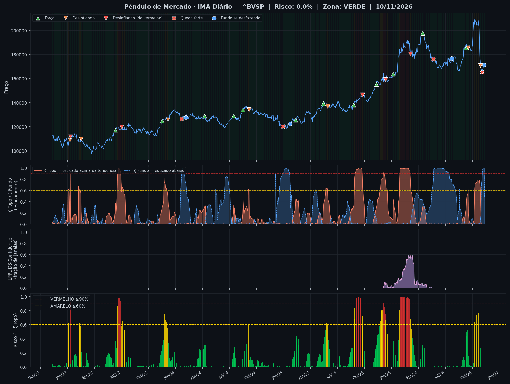
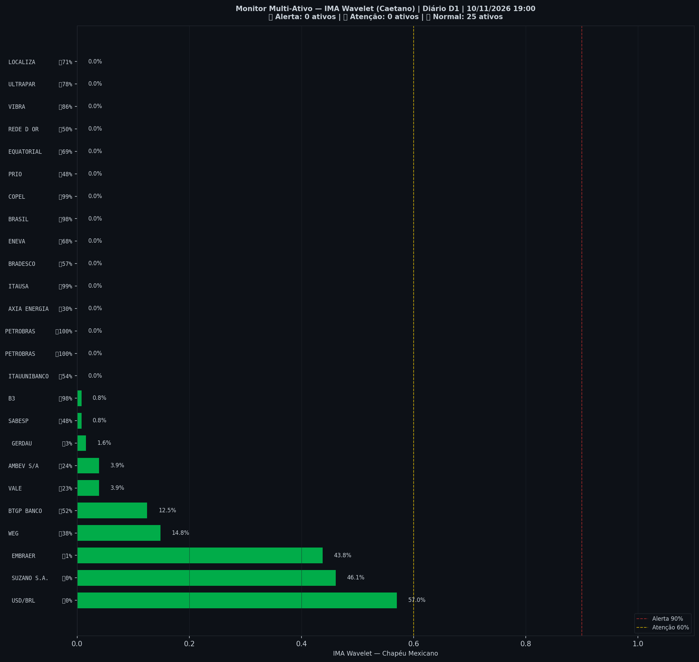

> [!success] Onde o mercado está no fechamento de 10/11: **🟢 Calmo**
> `Pânico ◀─────●───────────────▶ Euforia`
>
> O Ibovespa está dentro da sua faixa normal, sem excesso para cima nem para baixo.
>
> *Leitura educacional baseada em 26 anos de dados. Não é recomendação de investimento.*

> [!abstract]- 🧭 Os outros módulos neste dia (Operações e Sinais)
> | Módulo | Agora | |
> |---|---|---|
> | 📈 **Tendência MME9** | Diário — fora Semanal — fora | [abrir](operacoes/tendencia) |
> | 🎯 **Entradas do método** | ⏳ aguardando: Diário · Nadaraya, Diário · Semáforo N3 após ζ Fundo | [abrir](operacoes/entradas) |
> | 📍 **Sinais** | hoje: nenhum sinal | [abrir](sinais-topo-fundo/) |
> | 🧪 **Placar ao vivo** | 1 operação(ões), 0 com lucro, soma -0,8% | [abrir](operacoes/) |

> [!success] IMA Diário (10/11): 🟢 **VERDE** — Risco 0% · ＝ +0 p.p. vs leitura anterior
> `░░░░░░░░░░░░░░░░░░░░`
> Preço na faixa normal em torno da tendência.

> [!note] 🌱 **IMA Diário — evento de hoje: Fundo se desfazendo**
> *ζ Fundo voltou abaixo de 75% depois de passar de 90%*
> Só contexto: em 2001–2013 subiu em 71% das vezes em 3 meses, mas em 2014–2026 ficou igual a um dia qualquer (60% contra 62%). O pânico passou, sem vantagem para comprar só por isso (revisto em 23/10/2026).
> 📚 **Leitura histórica:** só contexto: o pânico passou; sem vantagem estatística confirmada para comprar só por isso
>
> Eventos recentes: 🌱 10/11 Fundo se desfazendo · 🔪 03/11 Queda forte em curso · 📉 28/10 Esticamento desinflando · 📉 16/09 Esticamento desinflando
>
> *Leitura educacional baseada em 26 anos de dados, não recomendação. [Como usar](../metodologia/crise#3-como-usar-na-prática).*

| Indicador — IMA Diário (10/11) | Valor |
|---|---|
| 🔴 ζ Topo — preço esticado acima da tendência | **0%** |
| 🔵 ζ Fundo — preço esticado abaixo da tendência | 48% |
| 🫧 LPPL bolha — alta super-exponencial (risco de crash) | 0% |
| 🫧 LPPL antibolha — queda super-exponencial (risco de repique) | 0% |
| 📊 Ibovespa | 171.337 pts |

## Últimos 30 pregões

| Data | Zona | Evento | Risco | ζ Topo | ζ Fundo | LPPL |
|---|---|---|---|---|---|---|
| 2026-11-10 | 🟢 VERDE | 🌱 | **0%** | 0% | 48% | 0% |
| 2026-11-09 | 🟢 VERDE |  | **0%** | 0% | 🔪 **100%** | 0% |
| 2026-11-06 | 🟢 VERDE |  | **0%** | 0% | 🔪 **100%** | 0% |
| 2026-11-05 | 🟢 VERDE |  | **0%** | 0% | 🔪 **99%** | 0% |
| 2026-11-04 | 🟢 VERDE |  | **0%** | 0% | 🔪 **100%** | 0% |
| 2026-11-03 | 🟢 VERDE | 🔪 | **0%** | 0% | 🔪 **95%** | 0% |
| 2026-10-30 | 🟢 VERDE |  | **0%** | 0% | 🔵 **66%** | 0% |
| 2026-10-29 | 🟢 VERDE |  | **4%** | 4% | 23% | 0% |
| 2026-10-28 | 🟢 VERDE | 📉 | **27%** | 27% | 14% | 0% |
| 2026-10-27 | 🟡 AMARELO |  | **50%** | 50% | 9% | 0% |
| 2026-10-26 | 🟡 AMARELO |  | 🟡 **66%** | 🟡 **66%** | 3% | 0% |
| 2026-10-23 | 🟡 AMARELO |  | 🟡 **79%** | 🟡 **79%** | 0% | 0% |
| 2026-10-22 | 🟡 AMARELO |  | 🟡 **78%** | 🟡 **78%** | 0% | 0% |
| 2026-10-21 | 🟡 AMARELO |  | 🟡 **77%** | 🟡 **77%** | 1% | 0% |
| 2026-10-20 | 🟡 AMARELO |  | 🟡 **77%** | 🟡 **77%** | 1% | 0% |
| 2026-10-19 | 🟡 AMARELO |  | 🟡 **77%** | 🟡 **77%** | 0% | 0% |
| 2026-10-16 | 🟡 AMARELO |  | 🟡 **77%** | 🟡 **77%** | 0% | 0% |
| 2026-10-15 | 🟡 AMARELO |  | 🟡 **75%** | 🟡 **75%** | 0% | 0% |
| 2026-10-14 | 🟡 AMARELO |  | 🟡 **74%** | 🟡 **74%** | 1% | 0% |
| 2026-10-13 | 🟡 AMARELO |  | 🟡 **74%** | 🟡 **74%** | 0% | 0% |
| 2026-10-09 | 🟡 AMARELO |  | 🟡 **72%** | 🟡 **72%** | 0% | 0% |
| 2026-10-08 | 🟡 AMARELO |  | 🟡 **63%** | 🟡 **63%** | 0% | 0% |
| 2026-10-07 | 🟢 VERDE |  | **40%** | 40% | 1% | 0% |
| 2026-10-06 | 🟢 VERDE |  | **25%** | 25% | 2% | 0% |
| 2026-10-05 | 🟢 VERDE |  | **6%** | 6% | 4% | 0% |
| 2026-10-02 | 🟢 VERDE |  | **2%** | 2% | 5% | 0% |
| 2026-10-01 | 🟢 VERDE |  | **0%** | 0% | 9% | 0% |
| 2026-09-30 | 🟢 VERDE |  | **0%** | 0% | 11% | 0% |
| 2026-09-29 | 🟢 VERDE |  | **0%** | 0% | 11% | 0% |
| 2026-09-28 | 🟢 VERDE |  | **1%** | 1% | 9% | 0% |

<small>Destaques: 🟡 ≥ 60% · 🔴 ≥ 90% (Risco e ζ Topo) · 🔵 ≥ 60% · 🔪 ≥ 90% (ζ Fundo) · 🫧 ≥ 30% · 🫧🔴 ≥ 50% (LPPL)</small>

## Monitor Multi-Ativo

**0% dos ativos em tensão** (0🔴 0🟡) · **11 com ζ Fundo alto** — quanto mais ativos disparam juntos, mais confiável o sinal.

> [!danger] Em destaque no multi-ativo
> 🔪 **PETROBRAS** ζ Fundo 100% · 🔪 **PETROBRAS** ζ Fundo 100% · 🔪 **ITAUSA** ζ Fundo 99% · 🔪 **COPEL** ζ Fundo 99% · 🔪 **B3** ζ Fundo 98% · 🔪 **BRASIL** ζ Fundo 98% · 🔵 **VIBRA** ζ Fundo 86% · 🔵 **ULTRAPAR** ζ Fundo 78% · 🔵 **LOCALIZA** ζ Fundo 71% · 🔵 **EQUATORIAL** ζ Fundo 69% · 🔵 **ENEVA** ζ Fundo 68%

| Zona | Ativo | Setor | ζ Topo | ζ Fundo |
|---|---|---|---|---|
| 🟢 | **PETROBRAS** | Petróleo | 0.0% | 🔪 **100.0%** |
| 🟢 | **PETROBRAS** | Petróleo | 0.0% | 🔪 **100.0%** |
| 🟢 | **ITAUSA** | Financeiro | 0.0% | 🔪 **99.2%** |
| 🟢 | **COPEL** | Energia | 0.0% | 🔪 **99.2%** |
| 🟢 | **B3** | Financeiro | 0.8% | 🔪 **98.4%** |
| 🟢 | **BRASIL** | Financeiro | 0.0% | 🔪 **98.4%** |
| 🟢 | **VIBRA** | Energia | 0.0% | 🔵 **85.9%** |
| 🟢 | **ULTRAPAR** | Outros | 0.0% | 🔵 **78.1%** |
| 🟢 | **LOCALIZA** | Aluguel | 0.0% | 🔵 **71.1%** |
| 🟢 | **EQUATORIAL** | Energia | 0.0% | 🔵 **68.8%** |
| 🟢 | **ENEVA** | Energia | 0.0% | 🔵 **68.0%** |
| 🟢 | **BRADESCO** | Financeiro | 0.0% | 57.0% |
| 🟢 | **USD/BRL** | Câmbio | 57.0% | 0.0% |
| 🟢 | **ITAUUNIBANCO** | Financeiro | 0.0% | 53.9% |
| 🟢 | **BTGP BANCO** | Financeiro | 12.5% | 51.6% |
| 🟢 | **REDE D OR** | Saúde | 0.0% | 50.0% |
| 🟢 | **SABESP** | Saneamento | 0.8% | 48.4% |
| 🟢 | **PRIO** | Petróleo | 0.0% | 47.7% |
| 🟢 | **SUZANO S.A.** | Papel/Celulose | 46.1% | 0.0% |
| 🟢 | **EMBRAER** | Outros | 43.8% | 0.8% |
| 🟢 | **WEG** | Industrial | 14.8% | 37.5% |
| 🟢 | **AXIA ENERGIA** | Energia | 0.0% | 29.7% |
| 🟢 | **AMBEV S/A** | Consumo | 3.9% | 24.2% |
| 🟢 | **VALE** | Mineração | 3.9% | 23.4% |
| 🟢 | **GERDAU** | Siderurgia | 1.6% | 3.1% |

<small>Destaques: 🟡 ≥ 60% · 🔴 ≥ 90% (Risco e ζ Topo) · 🔵 ≥ 60% · 🔪 ≥ 90% (ζ Fundo) · 🫧 ≥ 30% · 🫧🔴 ≥ 50% (LPPL)</small>

*Página atualizada em 10/11/2026 19:06 BRT (leitura da barra de 2026-11-10 BRT).*

> [!warning] O que este indicador não faz
> Medido em 5 anos de Ibovespa, o ζ **não antecipa** topos nem fundos: a capacidade de separar o que sobe do que cai ficou em 0,49–0,52, e 0,50 é moeda jogada ao ar. Ele descreve o estado de agora; não é aviso do que vem. As zonas verde/amarelo/vermelho continuam na página como descrição desse estado — **não as use como sinal de entrada ou saída**.

> [!info]- Como interpretar (clique para expandir)
> - **IMA Diário** e **IMA Intraday**: o mesmo cálculo (IMA Wavelet) aplicado ao fechamento diário e a barras de 15 minutos. São leituras independentes — uma não confirma nem desmente a outra.
> - **ζ Topo**: fração dos coeficientes wavelet (Chapéu Mexicano, Caetano & Yoneyama 2009) acima de +0,8σ na faixa mais recente. Na ponta da série isso acontece quando o preço termina **esticado acima da tendência** em muitas escalas. ζ=0,90 é o limiar de Caetano.
> - **ζ Fundo**: o espelho — preço esticado abaixo da tendência.
> - **ζ olha para trás, não para frente.** Ele mede esticamento que **já aconteceu**: sobe depois que o preço subiu e cai depois que o preço caiu (correlação medida de +0,59 com o retorno recente). Por isso ζ Topo **baixo no meio de um tombo é o comportamento correto** do indicador, e não defeito: o preço deixou de estar esticado para cima. Pelo mesmo motivo, ζ Topo alto não quer dizer que a queda começa amanhã.
> - **LPPL DS-Confidence**: fração de 45 janelas (60–500 pregões) em que o modelo de Sornette produz um ajuste válido. **Bolha** (B<0): alta super-exponencial, risco de crash. **Antibolha** (B>0): queda super-exponencial, risco de repique. Evidência complementar; **não entra na zona**.
> - **Zonas com histerese**: o sinal só muda de zona ao cruzar o limiar de entrada, e só volta ao cruzar o de saída — evita flip-flop diário.

---
*Pêndulo de Mercado · entre o pânico e a euforia, onde o mercado está. Sinal IMA baseado no trabalho do Prof. Marco Antonio Leonel Caetano (IMA Wavelet, [Caetano & Yoneyama, Physica-A 2007](https://doi.org/10.1016/j.physa.2007.03.054)) e do Prof. Didier Sornette (LPPL, ETH-Zurich); Sinais de Topo e Fundo baseados no trabalho de Oliver Velez, J. Welles Wilder, Donald Lambert, John Bollinger e Alex Spiroglou. Adaptado, testado no Ibovespa e mantido por Jarbas Daniel da Costa. Os autores citados não participam do produto. · [Metodologia](metodologia/) · [Histórico](historico)*

> [!quote]- Aviso
> Conteúdo educacional. Não constitui recomendação de investimento.
