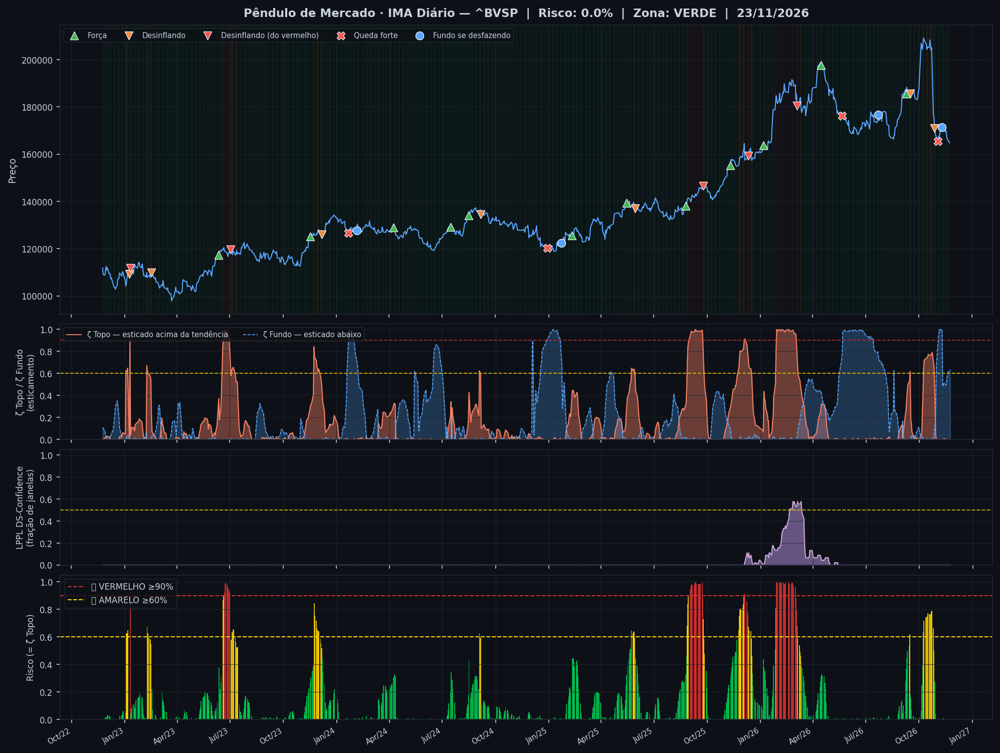
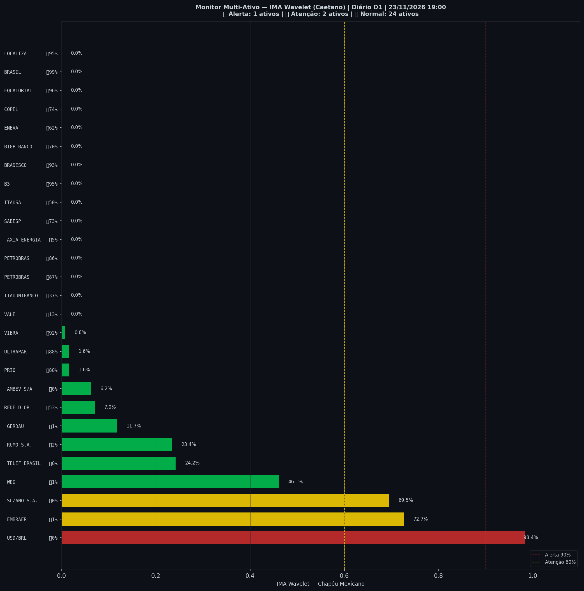

> [!info] Onde o mercado está no fechamento de 23/11: **🔵 Esticado para baixo**
> `Pânico ◀────●────────────────▶ Euforia`
>
> **O Ibovespa caiu 1,64% hoje, aos 164.796 pontos.** O preço caiu mais rápido que o normal e está abaixo da sua faixa habitual.
>
> *Leitura educacional baseada em 26 anos de dados. Não é recomendação de investimento.*

> [!abstract]- 🧭 Os outros módulos neste dia (Operações e Sinais)
> | Módulo | Agora | |
> |---|---|---|
> | 📈 **Tendência MME9** | Diário — fora Semanal — fora | [abrir](operacoes/tendencia) |
> | 🎯 **Entradas do método** | ⏳ aguardando: Diário · Semáforo N3 após ζ Fundo | [abrir](operacoes/entradas) |
> | 📍 **Sinais** | hoje: nenhum sinal | [abrir](sinais-topo-fundo/) |
> | 🧪 **Placar ao vivo** | 1 operação(ões), 0 com lucro, soma -0,8% | [abrir](operacoes/) |

> [!info] IMA Diário (23/11): 🔵 **ESTICADO P/ BAIXO** — ζ Fundo 63% · risco de topo 0% · ＝ +0 p.p. vs leitura anterior
> `█████████████░░░░░░░`
> Atenção — preço esticado abaixo da tendência. Medido por episódio, esta faixa não teve retorno melhor que um dia qualquer: +0,18% em 60 pregões contra +3,34% da base.

> [!warning] ⚠️ Nível alto agora — IMA Diário (23/11)
> - 🔵 **ζ Fundo 63%** — preço esticado abaixo da tendência

> [!note] 🧭 IMA Diário · situação: 🌱 **Fundo se desfazendo**
> 📚 só contexto: o pânico passou; sem vantagem estatística confirmada para comprar só por isso
>
> Eventos recentes: 🌱 10/11 Fundo se desfazendo · 🔪 03/11 Queda forte em curso · 📉 28/10 Esticamento desinflando · 📉 16/09 Esticamento desinflando
>
> *Leitura educacional baseada em 26 anos de dados, não recomendação. [Como usar](../metodologia/crise#3-como-usar-na-prática).*

| Indicador — IMA Diário (23/11) | Valor |
|---|---|
| 🔴 ζ Topo — preço esticado acima da tendência | **0%** |
| 🔵 ζ Fundo — preço esticado abaixo da tendência | 🔵 **63%** |
| 🫧 LPPL bolha — alta super-exponencial (risco de crash) | 0% |
| 🫧 LPPL antibolha — queda super-exponencial (risco de repique) | 0% |
| 📊 Ibovespa | 164.796 pts |

## Últimos 30 pregões

| Data | Zona | Evento | Risco | ζ Topo | ζ Fundo | LPPL |
|---|---|---|---|---|---|---|
| 2026-11-23 | 🟢 VERDE |  | **0%** | 0% | 🔵 **63%** | 0% |
| 2026-11-19 | 🟢 VERDE |  | **0%** | 0% | 🔵 **61%** | 0% |
| 2026-11-18 | 🟢 VERDE |  | **0%** | 0% | 58% | 0% |
| 2026-11-17 | 🟢 VERDE |  | **0%** | 0% | 55% | 0% |
| 2026-11-16 | 🟢 VERDE |  | **0%** | 0% | 49% | 0% |
| 2026-11-13 | 🟢 VERDE |  | **1%** | 1% | 52% | 0% |
| 2026-11-12 | 🟢 VERDE |  | **1%** | 1% | 51% | 0% |
| 2026-11-11 | 🟢 VERDE |  | **0%** | 0% | 48% | 0% |
| 2026-11-10 | 🟢 VERDE | 🌱 | **0%** | 0% | 48% | 0% |
| 2026-11-09 | 🟢 VERDE |  | **0%** | 0% | 🔪 **100%** | 0% |
| 2026-11-06 | 🟢 VERDE |  | **0%** | 0% | 🔪 **100%** | 0% |
| 2026-11-05 | 🟢 VERDE |  | **0%** | 0% | 🔪 **99%** | 0% |
| 2026-11-04 | 🟢 VERDE |  | **0%** | 0% | 🔪 **100%** | 0% |
| 2026-11-03 | 🟢 VERDE | 🔪 | **0%** | 0% | 🔪 **95%** | 0% |
| 2026-10-30 | 🟢 VERDE |  | **0%** | 0% | 🔵 **66%** | 0% |
| 2026-10-29 | 🟢 VERDE |  | **4%** | 4% | 23% | 0% |
| 2026-10-28 | 🟢 VERDE | 📉 | **27%** | 27% | 14% | 0% |
| 2026-10-27 | 🟡 AMARELO |  | **50%** | 50% | 9% | 0% |
| 2026-10-26 | 🟡 AMARELO |  | 🟡 **66%** | 🟡 **66%** | 3% | 0% |
| 2026-10-23 | 🟡 AMARELO |  | 🟡 **79%** | 🟡 **79%** | 0% | 0% |
| 2026-10-22 | 🟡 AMARELO |  | 🟡 **78%** | 🟡 **78%** | 0% | 0% |
| 2026-10-21 | 🟡 AMARELO |  | 🟡 **77%** | 🟡 **77%** | 1% | 0% |
| 2026-10-20 | 🟡 AMARELO |  | 🟡 **77%** | 🟡 **77%** | 1% | 0% |
| 2026-10-19 | 🟡 AMARELO |  | 🟡 **77%** | 🟡 **77%** | 0% | 0% |
| 2026-10-16 | 🟡 AMARELO |  | 🟡 **77%** | 🟡 **77%** | 0% | 0% |
| 2026-10-15 | 🟡 AMARELO |  | 🟡 **75%** | 🟡 **75%** | 0% | 0% |
| 2026-10-14 | 🟡 AMARELO |  | 🟡 **74%** | 🟡 **74%** | 1% | 0% |
| 2026-10-13 | 🟡 AMARELO |  | 🟡 **74%** | 🟡 **74%** | 0% | 0% |
| 2026-10-09 | 🟡 AMARELO |  | 🟡 **72%** | 🟡 **72%** | 0% | 0% |
| 2026-10-08 | 🟡 AMARELO |  | 🟡 **63%** | 🟡 **63%** | 0% | 0% |

<small>Destaques: 🟡 ≥ 60% · 🔴 ≥ 90% (Risco e ζ Topo) · 🔵 ≥ 60% · 🔪 ≥ 90% (ζ Fundo) · 🫧 ≥ 30% · 🫧🔴 ≥ 50% (LPPL)</small>

## Monitor Multi-Ativo

**11% dos ativos em tensão** (1🔴 2🟡) · **14 com ζ Fundo alto** — quanto mais ativos disparam juntos, mais confiável o sinal.

> [!danger] Em destaque no multi-ativo
> 🔪 **BRASIL** ζ Fundo 99% · 🔴 **USD/BRL** ζ Topo 98% · 🔪 **EQUATORIAL** ζ Fundo 96% · 🔪 **B3** ζ Fundo 95% · 🔪 **LOCALIZA** ζ Fundo 95% · 🔪 **BRADESCO** ζ Fundo 93% · 🔪 **VIBRA** ζ Fundo 92% · 🔵 **ULTRAPAR** ζ Fundo 88% · 🔵 **PETROBRAS** ζ Fundo 87% · 🔵 **PETROBRAS** ζ Fundo 86% · 🔵 **PRIO** ζ Fundo 80% · 🔵 **COPEL** ζ Fundo 74% · 🔵 **SABESP** ζ Fundo 73% · 🟡 **EMBRAER** ζ Topo 73% · 🔵 **BTGP BANCO** ζ Fundo 70% · 🟡 **SUZANO S.A.** ζ Topo 70% · 🔵 **ENEVA** ζ Fundo 62%

| Zona | Ativo | Setor | ζ Topo | ζ Fundo |
|---|---|---|---|---|
| 🟢 | **BRASIL** | Financeiro | 0.0% | 🔪 **99.2%** |
| 🔴 | **USD/BRL** | Câmbio | 🔴 **98.4%** | 0.0% |
| 🟢 | **EQUATORIAL** | Energia | 0.0% | 🔪 **96.1%** |
| 🟢 | **B3** | Financeiro | 0.0% | 🔪 **94.5%** |
| 🟢 | **LOCALIZA** | Aluguel | 0.0% | 🔪 **94.5%** |
| 🟢 | **BRADESCO** | Financeiro | 0.0% | 🔪 **93.0%** |
| 🟢 | **VIBRA** | Energia | 0.8% | 🔪 **92.2%** |
| 🟢 | **ULTRAPAR** | Outros | 1.6% | 🔵 **87.5%** |
| 🟢 | **PETROBRAS** | Petróleo | 0.0% | 🔵 **86.7%** |
| 🟢 | **PETROBRAS** | Petróleo | 0.0% | 🔵 **85.9%** |
| 🟢 | **PRIO** | Petróleo | 1.6% | 🔵 **80.5%** |
| 🟢 | **COPEL** | Energia | 0.0% | 🔵 **74.2%** |
| 🟢 | **SABESP** | Saneamento | 0.0% | 🔵 **73.4%** |
| 🟡 | **EMBRAER** | Outros | 🟡 **72.7%** | 0.8% |
| 🟢 | **BTGP BANCO** | Financeiro | 0.0% | 🔵 **69.5%** |
| 🟡 | **SUZANO S.A.** | Papel/Celulose | 🟡 **69.5%** | 0.0% |
| 🟢 | **ENEVA** | Energia | 0.0% | 🔵 **61.7%** |
| 🟢 | **REDE D OR** | Saúde | 7.0% | 53.1% |
| 🟢 | **ITAUSA** | Financeiro | 0.0% | 50.0% |
| 🟢 | **WEG** | Industrial | 46.1% | 0.8% |
| 🟢 | **ITAUUNIBANCO** | Financeiro | 0.0% | 36.7% |
| 🟢 | **TELEF BRASIL** | Outros | 24.2% | 0.0% |
| 🟢 | **RUMO S.A.** | Outros | 23.4% | 1.6% |
| 🟢 | **VALE** | Mineração | 0.0% | 13.3% |
| 🟢 | **GERDAU** | Siderurgia | 11.7% | 0.8% |
| 🟢 | **AMBEV S/A** | Consumo | 6.2% | 0.0% |
| 🟢 | **AXIA ENERGIA** | Energia | 0.0% | 5.5% |

<small>Destaques: 🟡 ≥ 60% · 🔴 ≥ 90% (Risco e ζ Topo) · 🔵 ≥ 60% · 🔪 ≥ 90% (ζ Fundo) · 🫧 ≥ 30% · 🫧🔴 ≥ 50% (LPPL)</small>

*Página atualizada em 23/11/2026 19:05 BRT (leitura da barra de 2026-11-23 BRT).*

> [!warning] O que este indicador não faz
> Medido em 5 anos de Ibovespa, o ζ **não antecipa** topos nem fundos: a capacidade de separar o que sobe do que cai ficou em 0,49–0,52, e 0,50 é moeda jogada ao ar. Ele descreve o estado de agora; não é aviso do que vem. As zonas verde/amarelo/vermelho continuam na página como descrição desse estado — **não as use como sinal de entrada ou saída**.

> [!info]- Como interpretar (clique para expandir)
> - **IMA Diário** e **IMA Intraday**: o mesmo cálculo (IMA Wavelet) aplicado ao fechamento diário e a barras de 15 minutos. São leituras independentes — uma não confirma nem desmente a outra.
> - **ζ Topo**: fração dos coeficientes wavelet (Chapéu Mexicano, Caetano & Yoneyama 2009) acima de +0,8σ na faixa mais recente. Na ponta da série isso acontece quando o preço termina **esticado acima da tendência** em muitas escalas. ζ=0,90 é o limiar de Caetano.
> - **ζ Fundo**: o espelho — preço esticado abaixo da tendência.
> - **ζ olha para trás, não para frente.** Ele mede esticamento que **já aconteceu**: sobe depois que o preço subiu e cai depois que o preço caiu (correlação medida de +0,59 com o retorno recente). Por isso ζ Topo **baixo no meio de um tombo é o comportamento correto** do indicador, e não defeito: o preço deixou de estar esticado para cima. Pelo mesmo motivo, ζ Topo alto não quer dizer que a queda começa amanhã.
> - **LPPL DS-Confidence**: fração de 45 janelas (60–500 pregões) em que o modelo de Sornette produz um ajuste válido. **Bolha** (B<0): alta super-exponencial, risco de crash. **Antibolha** (B>0): queda super-exponencial, risco de repique. Evidência complementar; **não entra na zona**.
> - **Zonas com histerese**: o sinal só muda de zona ao cruzar o limiar de entrada, e só volta ao cruzar o de saída — evita flip-flop diário.

---
*Pêndulo de Mercado · entre o pânico e a euforia, onde o mercado está. Sinal IMA baseado no trabalho do Prof. Marco Antonio Leonel Caetano (IMA Wavelet, [Caetano & Yoneyama, Physica-A 2007](https://doi.org/10.1016/j.physa.2007.03.054)) e do Prof. Didier Sornette (LPPL, ETH-Zurich); Sinais de Topo e Fundo baseados no trabalho de Oliver Velez, J. Welles Wilder, Donald Lambert, John Bollinger e Alex Spiroglou. Adaptado, testado no Ibovespa e mantido por Jarbas Daniel da Costa. Os autores citados não participam do produto. · [Metodologia](metodologia/) · [Histórico](historico)*

> [!quote]- Aviso
> Conteúdo educacional. Não constitui recomendação de investimento.
