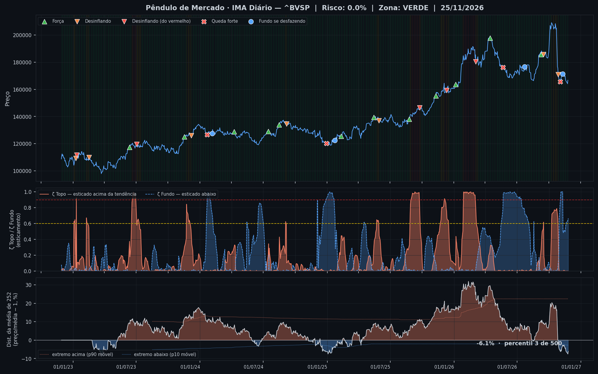
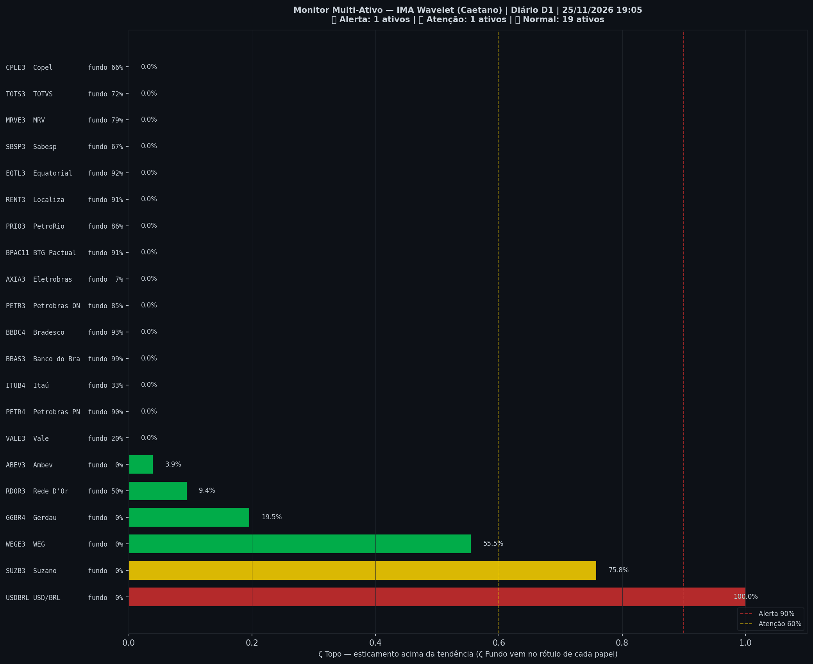

0% ζ Topo66% ζ Fundo−6,1% Dist. da média · p3

fechamento de 25/11/2026 · pregões

> [!info] Onde o mercado está no fechamento de 25/11: **🔵 Esticado para baixo**
> `Pânico ◀───●─────────────────▶ Euforia` · ζ Topo **0%** · ζ Fundo **66%** · régua = ζ Topo − ζ Fundo = **−66 p.p.**
>
> **O Ibovespa subiu 1,58% hoje, aos 166.685 pontos.** Mesmo assim, o preço segue abaixo da sua faixa habitual.
>
> *Leitura educacional baseada em 26 anos de dados. Não é recomendação de investimento.*

> [!info] IMA Diário (25/11): 🔵 **ESTICADO P/ BAIXO** — ζ Fundo **66%** · ζ Topo 0% · ＝ +0 p.p. vs leitura anterior
> `█████████████░░░░░░░` **66%**
> Atenção — preço esticado abaixo da tendência. Medido por episódio, esta faixa não teve retorno melhor que um dia qualquer: +0,18% em 60 pregões contra +3,34% da base.

> [!warning] ⚠️ Nível alto agora — IMA Diário (25/11)
> - 🔵 **ζ Fundo 66%** — preço esticado abaixo da tendência

> [!note] 🧭 IMA Diário · situação: 🌱 **Fundo se desfazendo**
> 📚 só contexto: o pânico passou; sem vantagem estatística confirmada para comprar só por isso
>
> Eventos recentes: 🌱 10/11 Fundo se desfazendo · 🔪 03/11 Queda forte em curso · 📉 28/10 Esticamento desinflando · 📉 16/09 Esticamento desinflando
>
> *Leitura educacional baseada em 26 anos de dados, não recomendação. [Como usar](../metodologia/crise#3-como-usar-na-prática).*

| Indicador — IMA Diário (25/11) | Valor |
|---|---|
| ζ Topo — preço esticado acima da tendência | **0%** |
| 🔵 ζ Fundo — preço esticado abaixo da tendência | 🔵 **66%** |
| 🔵 Zona | ESTICADO P/ BAIXO |
| 📊 Ibovespa | 166.685 pts ▲ (+1,58%) |
| 📏 Distância da média | 🔵 −6,1% (p3) |
| 🛰️ Fonte do preço | Yahoo, fechamento ajustado |

> [!warning] O que o acervo mede sobre esta situação
> **Medido** em 25 anos (2001–2026), contado por episódio e não por pregão repetido: depois de **ζ Fundo ≥ 60%**, o Ibovespa teve retorno mediano de **−0,78% em 60 pregões** e subiu em **46,7%** dos casos — contra **+3,30%** e **60,4%** de um pregão qualquer (46 episódios). Com ζ Fundo ≥ 90% é pior: −1,90% e 44,8% (30 episódios). **Não é região de compra para carregar.**
>
> **Indício, não medição firme.** Entre os episódios de ζ Fundo alto, os **18** em que o preço estava TAMBÉM no extremo baixo da distância (≤ p10) tiveram desfecho diferente em 60 pregões: +2,05% e 64,7% de alta, contra −0,62% e 47,6% dos outros 42. A separação se manteve nas duas metades do período (63,6% e 66,7% contra 50,0% e 46,2%), mas são **18 casos** e em 20 pregões o efeito não sobreviveu ao teste.
>
> **A leitura de agora está nesse recorte** — ζ Fundo alto com o preço no extremo baixo.
>
> **O que não fazer:** tratar o percentil baixo como sinal de compra — ele não é, nem em 20 pregões, onde o efeito some. E não ler o 🟢 do ζ Topo como risco baixo: ele mede esticamento para cima e não olha para o lado onde o mercado está. **O risco é de quem opera.**
> <small>Medição de 2026-11-24 21:22 · `estudo_fundo_e_distancia.py` · 6413 pregões no acervo</small>

## Últimos 30 pregões

| Data | Fechamento | Zona | Evento | ζ Topo | ζ Fundo | Dist. média |
|---|---|---|---|---|---|---|
| 2026-11-25 | 166.685 ▲ | 🔵 |  | **0%** | 🔵 **66%** | 🔵 −6,1% (p3) |
| 2026-11-24 | 164.090 ▼ | 🔵 |  | **0%** | 🔵 **64%** | 🔵 −7,5% (p0) |
| 2026-11-23 | 164.796 ▼ | 🔵 |  | **0%** | 🔵 **63%** | 🔵 −7,1% (p0) |
| 2026-11-19 | 166.376 ▼ | 🔵 |  | **0%** | 🔵 **61%** | 🔵 −6,2% (p2) |
| 2026-11-18 | 167.538 ▼ | 🟢 |  | **0%** | **58%** | 🔵 −5,6% (p3) |
| 2026-11-17 | 169.817 ▲ | 🟢 |  | **0%** | **55%** | 🔵 −4,3% (p5) |
| 2026-11-16 | 169.295 ▼ | 🟢 |  | **0%** | **49%** | 🔵 −4,5% (p5) |
| 2026-11-13 | 172.458 ▲ | 🟢 |  | **1%** | **52%** | 🔵 −2,7% (p9) |
| 2026-11-12 | 171.324 ▼ | 🟢 |  | **1%** | **51%** | 🔵 −3,3% (p7) |
| 2026-11-11 | 172.060 ▲ | 🟢 |  | **0%** | **48%** | 🔵 −2,8% (p8) |
| 2026-11-10 | 171.337 ▼ | 🟢 | 🌱 | **0%** | **48%** | 🔵 −3,2% (p7) |
| 2026-11-09 | 172.236 ▲ | 🔪 |  | **0%** | 🔪 **100%** | 🔵 −2,6% (p9) |
| 2026-11-06 | 168.499 ▲ | 🔪 |  | **0%** | 🔪 **100%** | 🔵 −4,7% (p4) |
| 2026-11-05 | 166.192 ▼ | 🔪 |  | **0%** | 🔪 **99%** | 🔵 −6,0% (p3) |
| 2026-11-04 | 167.564 ▲ | 🔪 |  | **0%** | 🔪 **100%** | 🔵 −5,2% (p3) |
| 2026-11-03 | 165.529 ▼ | 🔪 | 🔪 | **0%** | 🔪 **95%** | 🔵 −6,3% (p2) |
| 2026-10-30 | 167.922 ▼ | 🔵 |  | **0%** | 🔵 **66%** | 🔵 −4,9% (p4) |
| 2026-10-29 | 169.186 ▼ | 🟢 |  | **4%** | **23%** | 🔵 −4,1% (p4) |
| 2026-10-28 | 171.006 ▼ | 🟢 | 📉 | **27%** | **14%** | 🔵 −3,0% (p6) |
| 2026-10-27 | 175.710 ▼ | 🟡 |  | **50%** | **9%** | −0,3% (p15) |
| 2026-10-26 | 176.608 ▼ | 🟡 |  | 🟡 **66%** | **3%** | +0,3% (p18) |
| 2026-10-23 | 205.083 ▲ | 🟡 |  | 🟡 **79%** | **0%** | +16,5% (p77) |
| 2026-10-22 | 204.120 ▼ | 🟡 |  | 🟡 **78%** | **0%** | +16,1% (p76) |
| 2026-10-21 | 206.495 ▼ | 🟡 |  | 🟡 **77%** | **1%** | +17,7% (p81) |
| 2026-10-20 | 208.296 ▲ | 🟡 |  | 🟡 **77%** | **1%** | +18,9% (p85) |
| 2026-10-19 | 205.079 ▼ | 🟡 |  | 🟡 **77%** | **0%** | +17,2% (p80) |
| 2026-10-16 | 205.430 ▲ | 🟡 |  | 🟡 **77%** | **0%** | +17,6% (p81) |
| 2026-10-15 | 204.324 ▼ | 🟡 |  | 🟡 **75%** | **0%** | +17,1% (p80) |
| 2026-10-14 | 206.506 ▼ | 🟡 |  | 🟡 **74%** | **1%** | +18,5% (p84) |
| 2026-10-13 | 206.888 ▼ | 🟡 |  | 🟡 **74%** | **0%** | +18,9% (p85) |

<small>Destaques: 🟡 ≥ 60% · 🔴 ≥ 90% (ζ Topo) · 🔵 ≥ 60% · 🔪 ≥ 90% (ζ Fundo) **Zona**: 🟢 calmo, 🟡 atenção e 🔴 extremo vêm do ζ Topo; 🔵 FUNDO (ζ Fundo ≥ 60%) e 🔪 FACA (≥ 90%) vêm do ζ Fundo e têm precedência, porque queda em andamento é fato medido, não previsão. **Dist. média**: a distância do preço à média dos 252 pregões — **≈ 1 ano** — e, entre parênteses, o percentil dessa distância nos 500 pregões anteriores (**≈ 2 anos**). `−8,2% (p0)` = o preço está 8,2% **abaixo** da média e nunca esteve tão abaixo em toda a janela. 🔵 ≤ p10 · 🔴 ≥ p90. É a régua simples contra a qual o ζ precisa provar que acrescenta algo.</small>

## Monitor Multi-Ativo

**67% dos ativos em tensão** (14 de 21 · 5🔪 7🔵 1🔴 1🟡) · leitura de 25/11 19:05 BRT, pregão — quanto mais ativos disparam juntos, mais confiável o sinal. 🔪 e 🔵 vêm do ζ Fundo; 🔴 e 🟡, do ζ Topo.

*Origem do preço: Yahoo, fechamento ajustado (21).*

> [!danger] Em destaque no multi-ativo
> 🔴 **USD/BRL** `USDBRL=X` ζ Topo 100% · 🔪 **Banco do Brasil** `BBAS3` ζ Fundo 99% · 🔪 **Bradesco** `BBDC4` ζ Fundo 93% · 🔪 **Equatorial** `EQTL3` ζ Fundo 92% · 🔪 **BTG Pactual** `BPAC11` ζ Fundo 91% · 🔪 **Localiza** `RENT3` ζ Fundo 91% · 🔵 **Petrobras PN** `PETR4` ζ Fundo 90% · 🔵 **PetroRio** `PRIO3` ζ Fundo 86% · 🔵 **Petrobras ON** `PETR3` ζ Fundo 85% · 🔵 **MRV** `MRVE3` ζ Fundo 79% · 🟡 **Suzano** `SUZB3` ζ Topo 76% · 🔵 **TOTVS** `TOTS3` ζ Fundo 72% · 🔵 **Sabesp** `SBSP3` ζ Fundo 67% · 🔵 **Copel** `CPLE3` ζ Fundo 66%

| Zona | Ativo | Setor | Fechamento | ζ Topo | ζ Fundo | Dist. média |
|---|---|---|---|---|---|---|
| 🔴 | **USD/BRL** `USDBRL=X` | Câmbio | 5,82 ▼ | 🔴 **100.0%** | 0.0% | 🔴 +11,8% (p96) |
| 🔪 | **Banco do Brasil** `BBAS3` | Financeiro | 14,69 ▲ | 0.0% | 🔪 **99.2%** | 🔵 −31,5% (p1) |
| 🔪 | **Bradesco** `BBDC4` | Financeiro | 14,19 ▲ | 0.0% | 🔪 **93.0%** | 🔵 −20,1% (p2) |
| 🔪 | **Equatorial** `EQTL3` | Energia | 34,87 ▲ | 0.0% | 🔪 **92.2%** | 🔵 −12,1% (p7) |
| 🔪 | **BTG Pactual** `BPAC11` | Financeiro | 52,95 ▲ | 0.0% | 🔪 **91.4%** | 🔵 −6,8% (p9) |
| 🔪 | **Localiza** `RENT3` | Aluguel | 29,32 ▲ | 0.0% | 🔪 **90.6%** | 🔵 −29,1% (p8) |
| 🔵 | **Petrobras PN** `PETR4` | Petróleo | 41,36 ▲ | 0.0% | 🔵 **89.8%** | +1,3% (p37) |
| 🔵 | **PetroRio** `PRIO3` | Petróleo | 60,50 ▲ | 0.0% | 🔵 **85.9%** | +5,0% (p55) |
| 🔵 | **Petrobras ON** `PETR3` | Petróleo | 46,69 ▲ | 0.0% | 🔵 **85.2%** | +3,4% (p41) |
| 🔵 | **MRV** `MRVE3` | Construção | 4,62 ▲ | 0.0% | 🔵 **78.9%** | −30,8% (p12) |
| 🟡 | **Suzano** `SUZB3` | Papel/Celulose | 55,40 ▼ | 🟡 **75.8%** | 0.0% | 🔴 +17,1% (p98) |
| 🔵 | **TOTVS** `TOTS3` | Tecnologia | 31,81 ▲ | 0.0% | 🔵 **71.9%** | −10,1% (p27) |
| 🔵 | **Sabesp** `SBSP3` | Saneamento | 28,48 ▲ | 0.0% | 🔵 **67.2%** | +2,9% (p15) |
| 🔵 | **Copel** `CPLE3` | Energia | 14,90 ▼ | 0.0% | 🔵 **65.6%** | +2,0% (p11) |
| 🟢 | **WEG** `WEGE3` | Industrial | 49,65 ▼ | 55.5% | 0.0% | +4,4% (p49) |
| 🟢 | **Rede D'Or** `RDOR3` | Saúde | 36,80 ▲ | 9.4% | 50.0% | −2,4% (p27) |
| 🟢 | **Itaú** `ITUB4` | Financeiro | 40,01 ▲ | 0.0% | 32.8% | 🔵 −4,1% (p5) |
| 🟢 | **Vale** `VALE3` | Mineração | 56,90 ▲ | 0.0% | 20.3% | 🔵 −23,6% (p0) |
| 🟢 | **Gerdau** `GGBR4` | Siderurgia | 25,86 ▲ | 19.5% | 0.0% | +17,2% (p67) |
| 🟢 | **Eletrobras** `AXIA3` | Energia | 46,16 ▲ | 0.0% | 7.0% | 🔵 −17,0% (p1) |
| 🟢 | **Ambev** `ABEV3` | Consumo | 15,81 ▼ | 3.9% | 0.0% | +3,8% (p27) |

<small>Destaques: 🟡 ≥ 60% · 🔴 ≥ 90% (ζ Topo) · 🔵 ≥ 60% · 🔪 ≥ 90% (ζ Fundo) **Zona**: 🟢 calmo, 🟡 atenção e 🔴 extremo vêm do ζ Topo; 🔵 FUNDO (ζ Fundo ≥ 60%) e 🔪 FACA (≥ 90%) vêm do ζ Fundo e têm precedência, porque queda em andamento é fato medido, não previsão. **Dist. média**: a distância do preço à média dos 252 pregões — **≈ 1 ano** — e, entre parênteses, o percentil dessa distância nos 500 pregões anteriores (**≈ 2 anos**). `−8,2% (p0)` = o preço está 8,2% **abaixo** da média e nunca esteve tão abaixo em toda a janela. 🔵 ≤ p10 · 🔴 ≥ p90. É a régua simples contra a qual o ζ precisa provar que acrescenta algo.</small>

*Página atualizada em 25/11/2026 19:10 BRT (leitura da barra de 2026-11-25 BRT · fonte do preço: Yahoo, fechamento ajustado).*

> [!warning] O que este indicador não faz
> Medido em 5 anos de Ibovespa, o ζ **não antecipa** topos nem fundos: a capacidade de separar o que sobe do que cai ficou em 0,49–0,52, e 0,50 é moeda jogada ao ar. Ele descreve o estado de agora; não é aviso do que vem. As zonas verde/amarelo/vermelho continuam na página como descrição desse estado — **não as use como sinal de entrada ou saída**.

> [!info]- Como interpretar (clique para expandir)
> - **IMA Diário** e **IMA Intraday**: o mesmo cálculo (IMA Wavelet) aplicado ao fechamento diário e a barras de 15 minutos. São leituras independentes — uma não confirma nem desmente a outra.
> - **ζ Topo**: fração dos coeficientes wavelet (Chapéu Mexicano, Caetano & Yoneyama 2009) acima de +0,8σ na faixa mais recente. Na ponta da série isso acontece quando o preço termina **esticado acima da tendência** em muitas escalas. ζ=0,90 é o limiar de Caetano.
> - **ζ Fundo**: o espelho — preço esticado abaixo da tendência.
> - **ζ olha para trás, não para frente.** Ele mede esticamento que **já aconteceu**: sobe depois que o preço subiu e cai depois que o preço caiu (correlação medida de +0,59 com o retorno recente). Por isso ζ Topo **baixo no meio de um tombo é o comportamento correto** do indicador, e não defeito: o preço deixou de estar esticado para cima. Pelo mesmo motivo, ζ Topo alto não quer dizer que a queda começa amanhã.
> - **LPPL DS-Confidence**: fração de 45 janelas (60–500 pregões) em que o modelo de Sornette produz um ajuste válido. **Bolha** (B<0): alta super-exponencial, risco de crash. **Antibolha** (B>0): queda super-exponencial, risco de repique. Evidência complementar; **não entra na zona**.
> - **Zonas com histerese**: o sinal só muda de zona ao cruzar o limiar de entrada, e só volta ao cruzar o de saída — evita flip-flop diário.

---
*Pêndulo de Mercado · entre o pânico e a euforia, onde o mercado está. Sinal IMA baseado no trabalho do Prof. Marco Antonio Leonel Caetano (IMA Wavelet, [Caetano & Yoneyama, Physica-A 2007](https://doi.org/10.1016/j.physa.2007.03.054)) e do Prof. Didier Sornette (LPPL, ETH-Zurich); Sinais de Topo e Fundo baseados no trabalho de Oliver Velez, J. Welles Wilder, Donald Lambert, John Bollinger e Alex Spiroglou. Adaptado, testado no Ibovespa e mantido por Jarbas Daniel da Costa. Os autores citados não participam do produto. · [Metodologia](metodologia/) · [Histórico](historico)*

> [!quote]- Aviso
> Conteúdo educacional. Não constitui recomendação de investimento.
