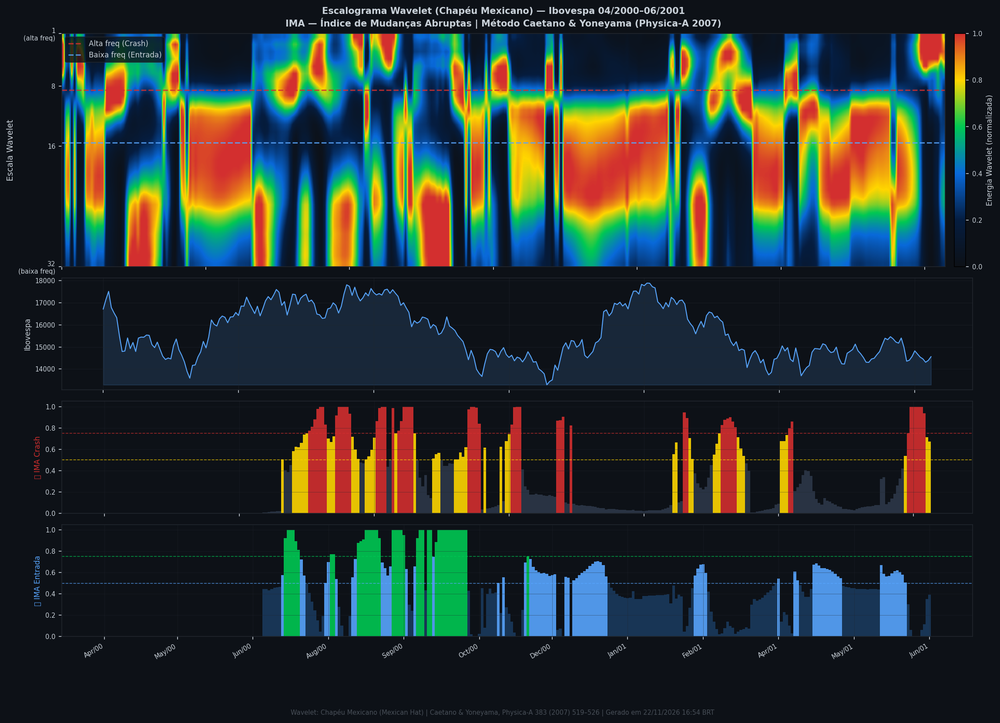
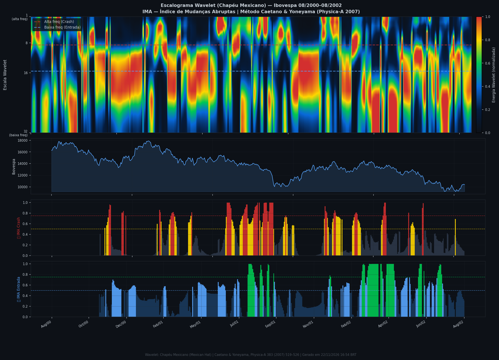
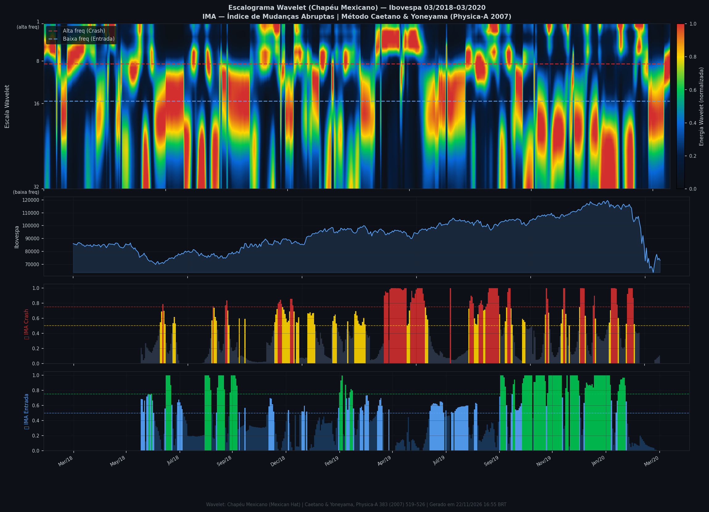

*Página refeita em 22/11/2026 17:00 · medição de 22/11/2026 às 16:45.*

Cada figura abaixo é o **mesmo escalograma** da [página do espectro](./), com a mesma wavelet e a mesma escala, apontado para uma janela do passado. Ao lado de cada uma está o que o sinal fez naquele episódio — medido, não lembrado.

> [!warning] Por que isto não é um manual de reconhecer padrão
>
> Olhar só os espectros das quedas que aconteceram **ensina a ver fantasma**. O olho humano acha padrão em qualquer coisa, e um painel escolhido pelos casos que deram errado é seleção pelo resultado: as milhares de vezes em que o espectro ficou parecido e nada aconteceu não estão aqui, porque não viraram episódio.
>
> O que estas figuras servem para fazer é **calibrar o olho** e, principalmente, ver **onde o sinal falhou** — que é a parte que nenhum catálogo costuma mostrar.

## 2001 — a crise argentina e o apagão

Topo em **26/01/2001**, e daí até o fundo o Ibovespa fez **-44,1%**.

| | o que fez neste tombo |
|---|---|
| ζ wavelet | O wavelet ligou **no dia** do topo, em 26/01/2001, com **100% da queda ainda pela frente**. |
| preço longe da média | **A régua simples não viu.** |

<small>Figura gerada em 22/11/2026 pelo `gerar_espectro_wavelet.py` sobre a mesma série que a medição usa. **Esta janela é mais curta que as outras**: a série começa em 2000 e não há de onde esticar. Painéis de larguras diferentes enganam o olho, que lê densidade de cor — não compare a intensidade desta com a das demais.</small>

## 2002 — a eleição e o risco-país

Topo em **04/03/2002**, e daí até o fundo o Ibovespa fez **-42,1%**.

| | o que fez neste tombo |
|---|---|
| ζ wavelet | O wavelet ligou **37 pregões antes** do topo, em 07/01/2002, com **99% da queda ainda pela frente**. |
| preço longe da média | **A régua simples não viu.** |

<small>Figura gerada em 22/11/2026 pelo `gerar_espectro_wavelet.py` sobre a mesma série que a medição usa.</small>

## 2008 — a crise do subprime

Topo em **20/05/2008**, e daí até o fundo o Ibovespa fez **-60,0%**.

| | o que fez neste tombo |
|---|---|
| ζ wavelet | **O wavelet não viu.** |
| preço longe da média | A régua simples ligou **114 pregões antes** do topo, em 28/11/2007, com **87% da queda ainda pela frente**. |

<small>Figura gerada em 22/11/2026 pelo `gerar_espectro_wavelet.py` sobre a mesma série que a medição usa.</small>

## 2020 — a pandemia

Topo em **23/01/2020**, e daí até o fundo o Ibovespa fez **-46,8%**.

| | o que fez neste tombo |
|---|---|
| ζ wavelet | O wavelet ligou **13 pregões antes** do topo, em 06/01/2020, com **97% da queda ainda pela frente**. |
| preço longe da média | A régua simples ligou **114 pregões antes** do topo, em 08/08/2019, com **83% da queda ainda pela frente**. |

<small>Figura gerada em 22/11/2026 pelo `gerar_espectro_wavelet.py` sobre a mesma série que a medição usa.</small>

## O que as quatro figuras dizem juntas

Nenhum dos dois pegou todos: o **wavelet** não viu 2008 e a **régua simples do preço** não viu 2001 e 2002. Eles falham em episódios **diferentes**, e é por isso que olhar um só deixa um buraco — um buraco com nome e data, que as tabelas acima mostram.

O wavelet enxerga **ruptura**: mudança abrupta de regime. Quando o topo se forma devagar e a queda é longa, há pouca descontinuidade para ele ver. Quando a virada é brusca, ele acende antes. A régua do preço esticado é o contrário — não liga para a forma da virada, só para a distância até a média.

> [!warning] O que NÃO fazer com estas figuras
>
> **Não procure a figura de hoje aqui.** Comparar o espectro atual com estes quatro é o mesmo erro de comparar com 1929: quatro episódios escolhidos por terem dado errado não são amostra de nada.
>
> **Não leia a borda direita de nenhuma delas.** A wavelet precisa de dados dos dois lados de cada ponto. Aqui a borda direita tem esse "depois" porque é passado — e é justamente por isso que estas figuras são mais nítidas que a da página principal, onde a ponta ainda não tem futuro. **Comparar a nitidez das duas é comparar artefato de cálculo.**
>
> **Não confunda o IMA desenhado com o medido.** A figura recalcula o IMA dentro da própria janela; o número das tabelas veio da série contínua. Mesma fórmula, origens diferentes — perto do começo de cada figura os dois podem divergir.

<small>Leitura de risco a partir de dado público, não recomendação. Quem monta a posição carrega o risco.</small>

[🌊 Espectro wavelet](./) · [📊 Amplitude](../amplitude/) · [Metodologia](../metodologia/crise/)

