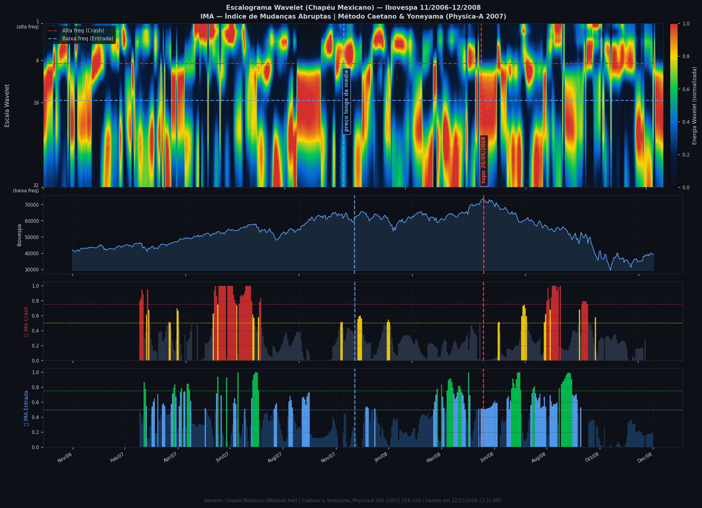
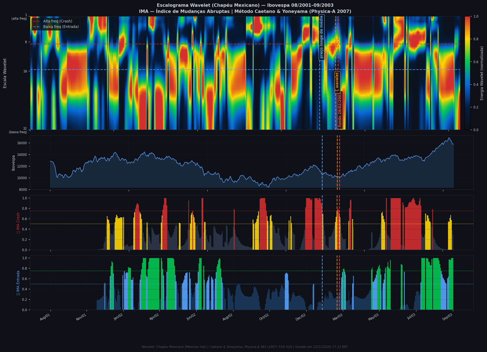
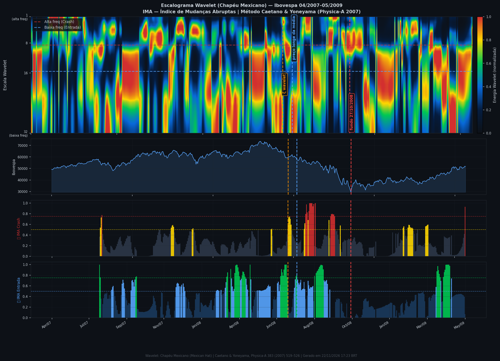
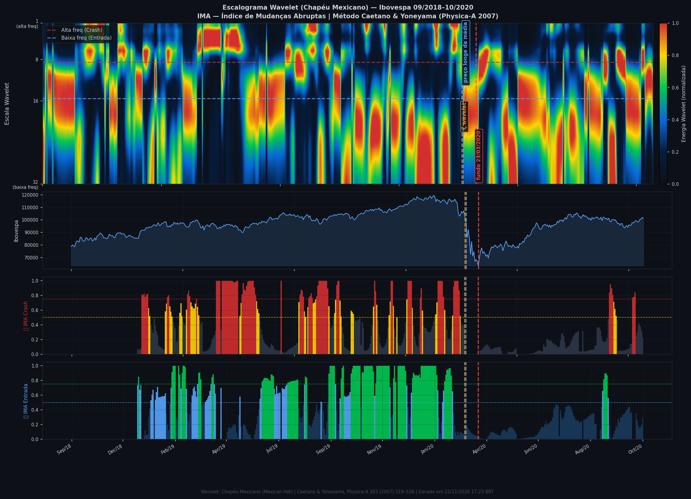
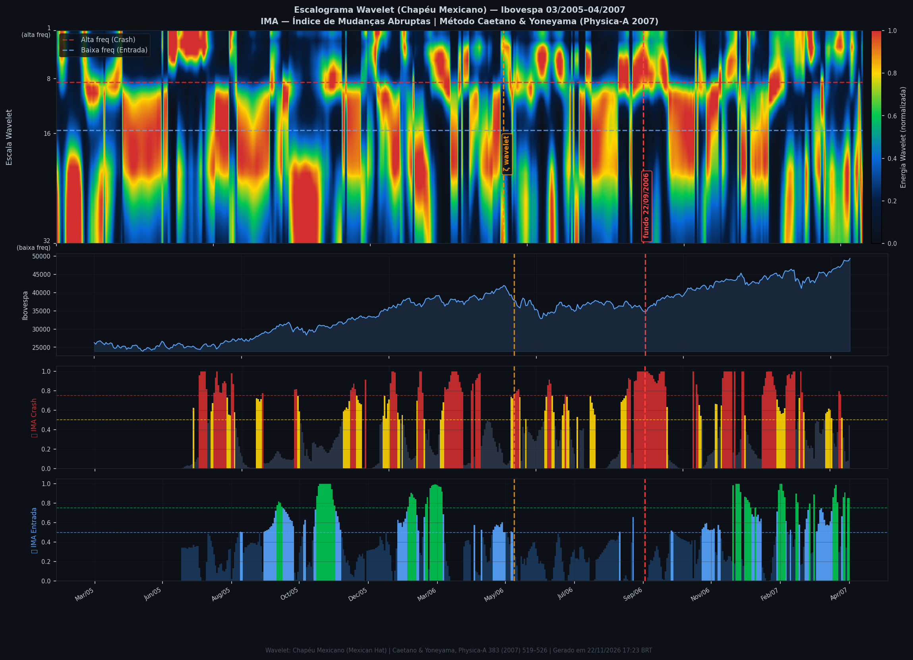

*Página refeita em 22/11/2026 17:23 · medição de 22/11/2026 às 16:45.*

Cada figura é o **mesmo escalograma** da [página do espectro](./), com a mesma wavelet e a mesma escala, apontado para uma janela do passado — e com **o dia marcado**: o extremo em vermelho, e o dia em que cada sinal ligou na cor dele. A distância entre a linha vermelha e a colorida é, visualmente, o que o aviso valeu.

> [!warning] Por que isto não é um manual de reconhecer padrão
>
> Olhar só os espectros das viradas que aconteceram **ensina a ver fantasma**. O olho acha padrão em qualquer coisa, e um painel escolhido pelos casos que deram certo é seleção pelo resultado: as milhares de vezes em que o espectro ficou parecido e nada aconteceu não estão aqui, porque não viraram episódio.
>
> Serve para **calibrar o olho** e, principalmente, para ver **onde o sinal falhou** — a parte que nenhum catálogo costuma mostrar.

# Os grandes tombos

Quedas de 40% ou mais a partir do topo. São poucos: cabem nos dedos de uma mão em mais de vinte anos.

## 2008 — a crise do subprime

Topo em **20/05/2008**, e daí até o fundo o Ibovespa fez **-60,0%**.

| | o que fez neste episódio |
|---|---|
| 🟠 ζ wavelet | **O wavelet não viu.** |
| 🔵 preço longe da média | A régua simples ligou **114 pregões antes** do topo, em 28/11/2007, com **87% da queda ainda pela frente**. |

<small>Linha **vermelha** = o topo. **Laranja** = o dia em que o ζ cruzou. **Azul** = o dia em que o preço longe da média cruzou. Marca ausente significa que aquele sinal não ligou neste episódio. Figura de 22/11/2026.</small>

## 2020 — a pandemia

Topo em **23/01/2020**, e daí até o fundo o Ibovespa fez **-46,8%**.

| | o que fez neste episódio |
|---|---|
| 🟠 ζ wavelet | O wavelet ligou **13 pregões antes** do topo, em 06/01/2020, com **97% da queda ainda pela frente**. |
| 🔵 preço longe da média | A régua simples ligou **114 pregões antes** do topo, em 08/08/2019, com **83% da queda ainda pela frente**. |

<small>Linha **vermelha** = o topo. **Laranja** = o dia em que o ζ cruzou. **Azul** = o dia em que o preço longe da média cruzou. Marca ausente significa que aquele sinal não ligou neste episódio. Figura de 22/11/2026.</small>

## 2001 — a crise argentina e o apagão

Topo em **26/01/2001**, e daí até o fundo o Ibovespa fez **-44,1%**.

| | o que fez neste episódio |
|---|---|
| 🟠 ζ wavelet | O wavelet ligou **no dia** do topo, em 26/01/2001, com **100% da queda ainda pela frente**. |
| 🔵 preço longe da média | **A régua simples não viu.** |

<small>Linha **vermelha** = o topo. **Laranja** = o dia em que o ζ cruzou. **Azul** = o dia em que o preço longe da média cruzou. Marca ausente significa que aquele sinal não ligou neste episódio. Figura de 22/11/2026.</small>

## 2002 — a eleição e o risco-país

Topo em **04/03/2002**, e daí até o fundo o Ibovespa fez **-42,1%**.

| | o que fez neste episódio |
|---|---|
| 🟠 ζ wavelet | O wavelet ligou **37 pregões antes** do topo, em 07/01/2002, com **99% da queda ainda pela frente**. |
| 🔵 preço longe da média | **A régua simples não viu.** |

<small>Linha **vermelha** = o topo. **Laranja** = o dia em que o ζ cruzou. **Azul** = o dia em que o preço longe da média cruzou. Marca ausente significa que aquele sinal não ligou neste episódio. Figura de 22/11/2026.</small>

# Os grandes fundos

Altas de 40% ou mais a partir do fundo. São **muito mais comuns** que os tombos — um índice volátil sobe 40% depois de um fundo com frequência. Por isso a lista aqui é uma seleção dos maiores episódios, não de todos.

## 2003 — a virada de 2003

Fundo em **26/02/2003**, e daí até o pico o Ibovespa fez **143,6%**.

| | o que fez neste episódio |
|---|---|
| 🟠 ζ wavelet | O wavelet ligou **3 pregões antes** do fundo, em 21/02/2003, com **94% da alta ainda pela frente**. |
| 🔵 preço longe da média | A régua simples ligou **22 pregões antes** do fundo, em 27/01/2003, com **91% da alta ainda pela frente**. |

<small>Linha **vermelha** = o fundo. **Laranja** = o dia em que o ζ cruzou. **Azul** = o dia em que o preço longe da média cruzou. Marca ausente significa que aquele sinal não ligou neste episódio. Figura de 22/11/2026.</small>

## 2008 — o fundo pós-Lehman

Fundo em **27/10/2008**, e daí até o pico o Ibovespa fez **128,4%**.

| | o que fez neste episódio |
|---|---|
| 🟠 ζ wavelet | O wavelet ligou **78 pregões antes** do fundo, em 08/07/2008, com **10% da alta ainda pela frente**. |
| 🔵 preço longe da média | A régua simples ligou **67 pregões antes** do fundo, em 24/07/2008, com **13% da alta ainda pela frente**. |

<small>Linha **vermelha** = o fundo. **Laranja** = o dia em que o ζ cruzou. **Azul** = o dia em que o preço longe da média cruzou. Marca ausente significa que aquele sinal não ligou neste episódio. Figura de 22/11/2026.</small>

## 2020 — o fundo da pandemia

Fundo em **23/03/2020**, e daí até o pico o Ibovespa fez **96,8%**.

| | o que fez neste episódio |
|---|---|
| 🟠 ζ wavelet | O wavelet ligou **12 pregões antes** do fundo, em 05/03/2020, com **23% da alta ainda pela frente**. |
| 🔵 preço longe da média | A régua simples ligou **11 pregões antes** do fundo, em 06/03/2020, com **29% da alta ainda pela frente**. |

<small>Linha **vermelha** = o fundo. **Laranja** = o dia em que o ζ cruzou. **Azul** = o dia em que o preço longe da média cruzou. Marca ausente significa que aquele sinal não ligou neste episódio. Figura de 22/11/2026.</small>

## 2006

Fundo em **22/09/2006**, e daí até o pico o Ibovespa fez **79,1%**.

| | o que fez neste episódio |
|---|---|
| 🟠 ζ wavelet | O wavelet ligou **89 pregões antes** do fundo, em 18/05/2006, com **82% da alta ainda pela frente**. |
| 🔵 preço longe da média | **A régua simples não viu.** |

<small>Linha **vermelha** = o fundo. **Laranja** = o dia em que o ζ cruzou. **Azul** = o dia em que o preço longe da média cruzou. Marca ausente significa que aquele sinal não ligou neste episódio. Figura de 22/11/2026.</small>

# O que as figuras dizem juntas

Nenhum dos dois pegou todos: o **wavelet** não viu 2008 e a **régua do preço** não viu 2001, 2002, 2006. Eles falham em episódios **diferentes** — e é por isso que olhar um só deixa um buraco com nome e data.

Nos **fundos** a diferença entre os dois é a maior de todas: o wavelet esteve ligado em 80% dos movimentos contra 59% da régua simples, e com muito mais do movimento ainda pela frente (82% contra 46%). É o lado em que ele ganha de verdade — ao contrário dos topos, onde os dois empatam.

O wavelet enxerga **ruptura**: mudança abrupta de regime. Quando a virada se forma devagar, há pouca descontinuidade para ele ver, e quem percebe é a régua trivial do preço esticado. Quando é brusca, o inverso.

> [!warning] O que NÃO fazer com estas figuras
>
> **Não procure a figura de hoje aqui.** Episódios escolhidos por terem dado errado não são amostra de nada.
>
> **Não compare a nitidez com a da página principal.** Aqui a borda direita tem o "depois" de que a wavelet precisa, porque é passado. Lá, não tem. A diferença é artefato de cálculo.
>
> **Não compare a intensidade entre figuras de larguras diferentes.** Janela mais curta concentra a cor, e o olho lê densidade.
>
> **Não confunda o IMA desenhado com o medido.** A figura recalcula o IMA dentro da própria janela; os números das tabelas vieram da série contínua.

<small>Leitura de risco a partir de dado público, não recomendação. Quem monta a posição carrega o risco.</small>

[🌊 Espectro wavelet](./) · [📊 Amplitude](../amplitude/) · [Metodologia](../metodologia/crise/)

