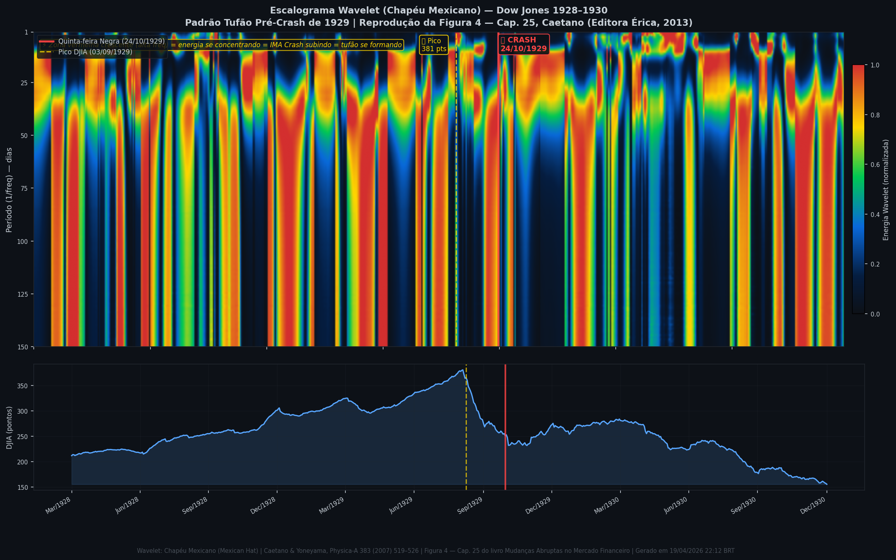

*Figura de **16/11/2026 às 17:00** · página refeita em 20/11/2026 19:19.*

> [!info] Esta página é **semanal**, não diária
> O espectro é recalculado **toda segunda-feira às 17h BRT** e só então esta página muda. As frequências do mercado se movem devagar: refazer isso todo dia gastaria máquina para mostrar a mesma figura. Todos os horários de atualização do site estão em [horários](../horarios/).

O **escalograma wavelet** decompõe o Ibovespa em frequências ao longo do tempo: em vez de uma linha de preço, mostra **quanta energia** o mercado tem em cada duração de ciclo, pregão por pregão. Ciclos longos embaixo, curtos em cima; quanto mais quente a cor, mais daquele movimento existe naquele momento.

Serve para uma pergunta que o preço não responde: **em que escala o mercado está se movendo agora?** Um mercado cuja energia está concentrada nos ciclos longos é um mercado de tendência. Um mercado cuja energia se espalhou para os ciclos curtos é um mercado agitado — o mesmo índice, com o preço andando igual, significando coisas diferentes para quem opera.

## Os últimos 504 pregões

<small>Escalograma por transformada wavelet contínua (wavelet Chapéu Mexicano) sobre 504 pregões do ^BVSP, com o IMA Crash e o IMA Entrada calculados na mesma série. Gerado em 16/11/2026 às 17:00 pelo `gerar_espectro_wavelet.py`.</small>

> [!note] O sinal em 19/11/2026
> **🌱 Fundo se desfazendo** · zona **VERDE** · risco **0,000** (amarelo em 0,60 · vermelho em 0,90)
> 
> só contexto: o pânico passou; sem vantagem estatística confirmada para comprar só por isso.

<small>O risco acima é a componente **IMA** (peso 1,0). A componente **LPPL** está com peso 0,0 no momento, isto é, desligada — o número não contém ajuste log-periódico. Isso é medição, não opinião: está escrito no próprio arquivo do sinal.</small>

## Como um colapso aparece aqui: 1929

A figura abaixo é o mesmo tipo de decomposição aplicada ao crash de 1929 — o colapso mais estudado da história dos mercados. Ela está aqui por um motivo específico: **para servir de régua**, não de profecia.

<small>Gerado uma única vez pelo `gerar_espectro_1929.py`, em 31/10/2026. Não é refeito: 1929 não muda.</small>

Um colapso de verdade tem assinatura: a energia **se concentra** numa faixa de frequências, depois **explode por todas as escalas ao mesmo tempo** — o mercado deixa de ter uma duração de ciclo dominante e passa a se mover em todas de uma vez. Tendo isso à vista, a figura de cima fica mais fácil de ler: dá para ver que ela **não** se parece com isso, e saber o que seria preciso ver para que se parecesse.

## Onde pode estar a vantagem

O espectro não dá entrada. Ele muda o **tamanho** da entrada e a **seletividade** — e é aí, se em algum lugar, que ele paga:

- **Energia nos ciclos longos** (calor concentrado embaixo): a tendência é a força dominante. Operar contra ela é brigar com a escala que manda. Posição menor no contra-tendência, ou nenhuma.
- **Energia espalhada para os ciclos curtos** (calor subindo na figura): mercado agitado. Os sinais diários ficam mais ruidosos, o stop é atingido mais vezes pelo mesmo movimento, e a resposta honesta é **posição menor**, não mais operações.
- **Mudança de regime de escala** é informação antes de o preço contar: a energia migra de faixa antes de a tendência virar visível no gráfico de linha.

Nada disso é gatilho. É contexto que decide **quanto** arriscar numa operação cuja entrada veio de outro lugar — do sinal diário, dos setups, do técnico.

## O que NÃO fazer

> [!warning] Não leia a borda direita da figura
> A wavelet precisa de dados dos **dois lados** de cada ponto para medir a energia ali. Nas últimas semanas do gráfico esse "depois" ainda não existe, então a borda direita é a parte **menos confiável** da figura — e é exatamente onde o olho vai primeiro. Quem lê a ponta como se fosse medida está lendo artefato de cálculo como se fosse mercado.

- **Não use a figura para entrar ou sair.** Ela não tem data de entrada, nem alvo, nem stop. Quem precisa disso tem as páginas de [sinais](../sinais-topo-fundo/) e de [operações](../operacoes/).
- **Não leia a semelhança com 1929 como previsão.** Escolher a figura mais famosa de colapso para comparar é selecionar pelo resultado: milhares de escalogramas nunca viraram crash e não ficaram famosos. A comparação calibra o olho; ela não mede probabilidade.
- **Não confunda esta figura com o sinal ao vivo.** O escalograma histórico é calculado com a série inteira, isto é, **vê o futuro** em cada ponto do passado. O sinal em tempo real não vê, e por isso concorda com ele só parcialmente. Está escrito na [metodologia](../metodologia/crise/).

<small>Isto é leitura de risco a partir de dado público, não recomendação. Quem monta a posição, carrega o risco.</small>

