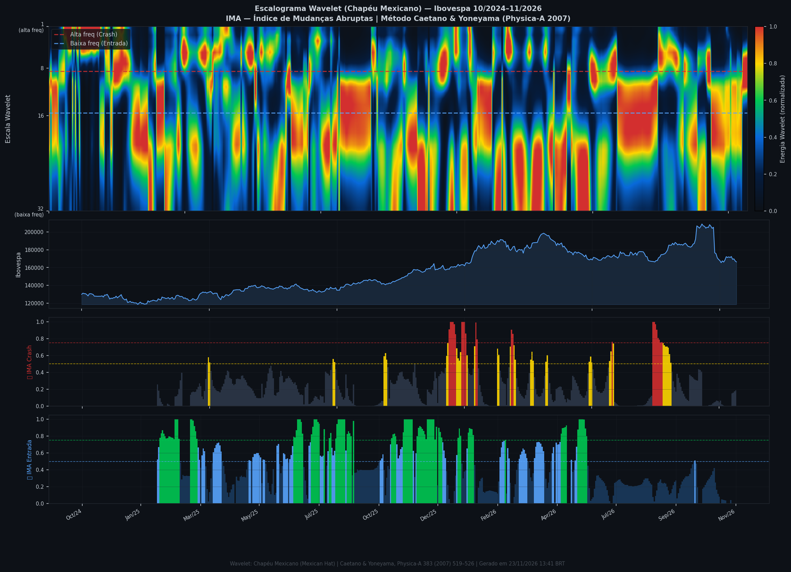

*Figura de **23/11/2026 às 13:41** · página refeita em 23/11/2026 13:41.*

> [!info] Esta página é **semanal**, não diária
> O espectro é recalculado **toda segunda-feira às 17h BRT** e só então esta página muda. As frequências do mercado se movem devagar: refazer isso todo dia gastaria máquina para mostrar a mesma figura. Todos os horários de atualização do site estão em [horários](../horarios/).

O **escalograma wavelet** decompõe o Ibovespa em frequências ao longo do tempo: em vez de uma linha de preço, mostra **quanta energia** o mercado tem em cada duração de ciclo, pregão por pregão. Ciclos longos embaixo, curtos em cima; quanto mais quente a cor, mais daquele movimento existe naquele momento.

Serve para uma pergunta que o preço não responde: **em que escala o mercado está se movendo agora?** Um mercado cuja energia está concentrada nos ciclos longos é um mercado de tendência. Um mercado cuja energia se espalhou para os ciclos curtos é um mercado agitado — o mesmo índice, com o preço andando igual, significando coisas diferentes para quem opera.

## Os últimos 504 pregões

<small>Escalograma por transformada wavelet contínua (wavelet Chapéu Mexicano) sobre 504 pregões do ^BVSP, com o IMA Crash e o IMA Entrada calculados na mesma série. Gerado em 23/11/2026 às 13:41 pelo `gerar_espectro_wavelet.py`.</small>

> [!note] O sinal em 23/11/2026 12:45 BRT
> **⚪ Neutro** · zona **VERDE** · risco **0,000** (amarelo em 0,60 · vermelho em 0,90)
> 
> sem diferença estatística em relação a um dia qualquer.
> 
> No diário de 19/11/2026: **🌱 Fundo se desfazendo** — só contexto: o pânico passou; sem vantagem estatística confirmada para comprar só por isso.

<small>O risco acima é a componente **IMA** (peso 1,0). A componente **LPPL** está com peso 0,0 no momento, isto é, desligada — o número não contém ajuste log-periódico. Isso é medição, não opinião: está escrito no próprio arquivo do sinal.</small>

## Como um colapso aparece aqui: 1929

A figura abaixo é o mesmo tipo de decomposição aplicada ao crash de 1929 — o colapso mais estudado da história dos mercados. Ela está aqui por um motivo específico: **para servir de régua**, não de profecia.

<small>Gerado uma única vez pelo `gerar_espectro_1929.py`, em 31/10/2026. Não é refeito: 1929 não muda.</small>

Um colapso de verdade tem assinatura: a energia **se concentra** numa faixa de frequências, depois **explode por todas as escalas ao mesmo tempo** — o mercado deixa de ter uma duração de ciclo dominante e passa a se mover em todas de uma vez. Tendo isso à vista, a figura de cima fica mais fácil de ler: dá para ver que ela **não** se parece com isso, e saber o que seria preciso ver para que se parecesse.

## O que este sinal acerta, e o que ele perde

A figura mostra o espectro. Esta seção responde outra coisa: **quando houve um grande topo, este sinal estava ligado?** É uma pergunta diferente de "o sinal dá lucro" — e é a que importa para quem quer estar atento a um evento raro.

Medido sobre **6.644 pregões** (03/01/2000 a 23/10/2026), com o ζ disponível de 05/01/2001 a 22/10/2026. Um **movimento** é o conjunto de pivôs que leva ao mesmo extremo — o crash de 2008 tem 14 pivôs e conta como **um**, senão o mesmo aviso seria contado catorze vezes.

### Os maiores tombos, um a um

Quedas de **40% ou mais**. Na coluna de cada sinal: quando ele ligou e quanto da queda ainda faltava nesse dia — é isso que o aviso valeu.

| topo | queda | ζ wavelet | preço longe da média |
|---|---|---|---|
| 26/01/2001 | -44,1% | no dia · restava 100% | **não viu** |
| 04/03/2002 | -42,1% | 37 pregões antes · restava 99% | **não viu** |
| 20/05/2008 | -60,0% | **não viu** | 114 pregões antes · restava 87% |
| 23/01/2020 | -46,8% | 13 pregões antes · restava 97% | 114 pregões antes · restava 83% |

**[🌪️ Veja o espectro de cada um destes tombos](grandes-tombos)** — o mesmo escalograma desta página, apontado para cada janela, com o que cada sinal fez em cada uma. Inclusive a que o wavelet não viu.

### Outros estudos deste sinal

- **[⚠ O ζ no teto da escala](zeta-no-teto)** — o que acontece depois que o ζ marca o máximo da escala. São 26 anos, com 2001, 2008 e 2020 dentro: ele marca o **começo** da queda forte, não o fim. Quem comprasse no primeiro sinal de 2008 estaria 32% abaixo em três meses.
- **[🔀 O ζ diário e o ζ intraday](diario-x-intraday)** — as 13 vezes em cinco anos em que os dois apontaram topo ao mesmo tempo, o que veio depois, e por que no lado do fundo não há nada.

### Cobertura e preço

| | ζ wavelet | preço longe da média |
|---|---|---|
| grandes topos | 71% dos movimentos | 71% |
| quanto do tombo ainda faltava | 82% | 83% |
| grandes fundos | 80% | 59% |
| quanto da alta ainda faltava | 82% | 46% |
| falsos alarmes por ano | **1,0** | 1,6 |

<small>Limiar 0,75. Cobertura = em quantos movimentos o sinal estava ligado na janela de 120 pregões antes a 40 depois do extremo. A janela olha para os dois lados de propósito: o ζ de fundo mede pânico, e pânico é máximo **na** capitulação — exigir aviso antes do fundo é pedir o impossível. Medição de 22/11/2026 às 17:28.</small>

<small>**Nos grandes topos, os dois empatam.** O wavelet não enxerga mais topos que a régua simples do preço longe da média: enxerga **os mesmos**. A diferença está no **preço**: 1,0 falsos alarmes por ano contra 1,6 da régua simples — os mesmos achados, por menos ruído. **Nos fundos a diferença é grande e favorece o wavelet**, em cobertura e no quanto da alta ainda restava quando o sinal ligou. A tabela dos tombos, acima, mostra caso a caso onde cada um acertou e onde falhou.</small>

### O que isso diz, e o que não diz

**Os dois sinais são complementares, e nenhum é suficiente.** O wavelet enxerga **ruptura** — mudança abrupta de regime. Quando um topo se forma devagar e a queda é longa, há pouca descontinuidade para ele ver, e quem percebe é a régua trivial do preço esticado. Quando a virada é brusca, o inverso. Olhar só um dos dois deixa um buraco que a tabela acima mostra com nome e data.

> [!warning] O que NÃO fazer com estes números
>
> **Não leia cobertura como lucro.** Cobertura diz que o sinal estava ligado, não que operar nele daria dinheiro. Testado à parte, o ζ como veto de entrada nas regras do site **não** melhorou nenhuma delas nos dois períodos.
>
> **Não trate o aviso como ordem.** Ao preço de cerca de um falso alarme por ano, este sinal paga se a reação for barata — olhar o gráfico, reduzir tamanho, apertar o stop. Se a reação for zerar posição, cada falso alarme custa a alta inteira, e aí a conta vira contra.
>
> **Não conclua a partir de meia dúzia de casos.** São os tombos de 40% ou mais em mais de vinte anos, e dá para contar nos dedos. Serve para calibrar o olho e para saber onde o sinal já falhou; não é amostra para estatística.

## Onde pode estar a vantagem

O espectro não dá entrada. Ele muda o **tamanho** da entrada e a **seletividade** — e é aí, se em algum lugar, que ele paga:

- **Energia nos ciclos longos** (calor concentrado embaixo): a tendência é a força dominante. Operar contra ela é brigar com a escala que manda. Posição menor no contra-tendência, ou nenhuma.
- **Energia espalhada para os ciclos curtos** (calor subindo na figura): mercado agitado. Os sinais diários ficam mais ruidosos, o stop é atingido mais vezes pelo mesmo movimento, e a resposta honesta é **posição menor**, não mais operações.
- **Mudança de regime de escala** é informação antes de o preço contar: a energia migra de faixa antes de a tendência virar visível no gráfico de linha.

Nada disso é gatilho. É contexto que decide **quanto** arriscar numa operação cuja entrada veio de outro lugar — do sinal diário, dos setups, do técnico.

## O que NÃO fazer

> [!warning] Não leia a borda direita da figura
> A wavelet precisa de dados dos **dois lados** de cada ponto para medir a energia ali. Nas últimas semanas do gráfico esse "depois" ainda não existe, então a borda direita é a parte **menos confiável** da figura — e é exatamente onde o olho vai primeiro. Quem lê a ponta como se fosse medida está lendo artefato de cálculo como se fosse mercado.

- **Não use a figura para entrar ou sair.** Ela não tem data de entrada, nem alvo, nem stop. Quem precisa disso tem as páginas de [sinais](../sinais-topo-fundo/) e de [operações](../operacoes/).
- **Não leia a semelhança com 1929 como previsão.** Escolher a figura mais famosa de colapso para comparar é selecionar pelo resultado: milhares de escalogramas nunca viraram crash e não ficaram famosos. A comparação calibra o olho; ela não mede probabilidade.
- **Não confunda esta figura com o sinal ao vivo.** O escalograma histórico é calculado com a série inteira, isto é, **vê o futuro** em cada ponto do passado. O sinal em tempo real não vê, e por isso concorda com ele só parcialmente. Está escrito na [metodologia](../metodologia/crise/).

<small>Isto é leitura de risco a partir de dado público, não recomendação. Quem monta a posição, carrega o risco.</small>

