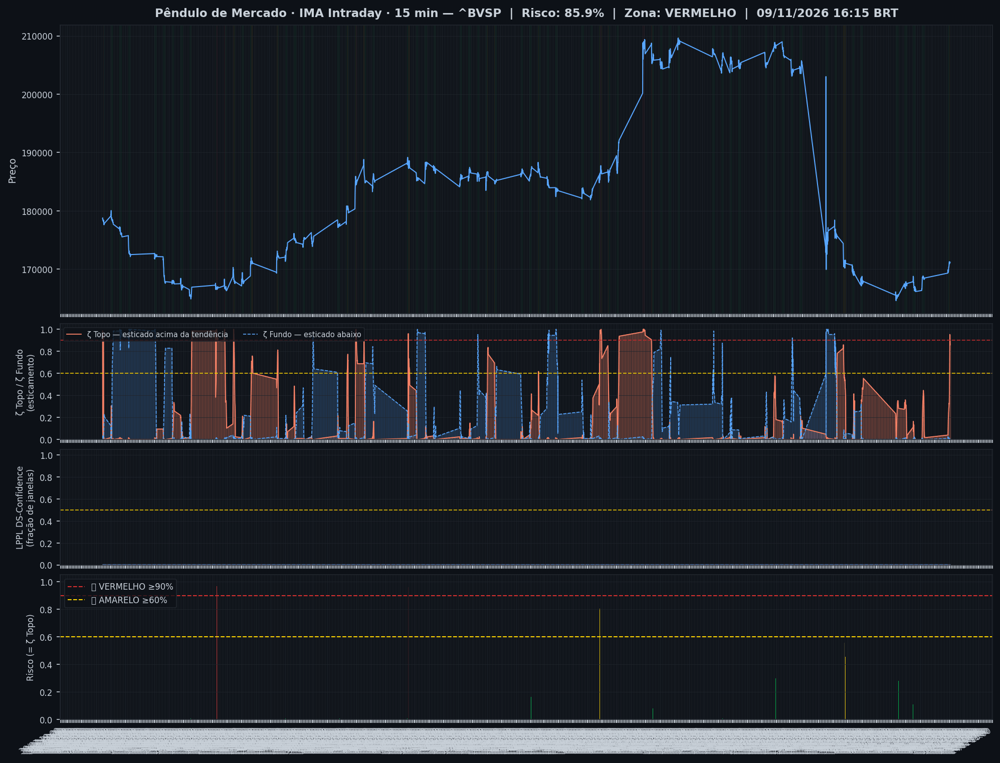
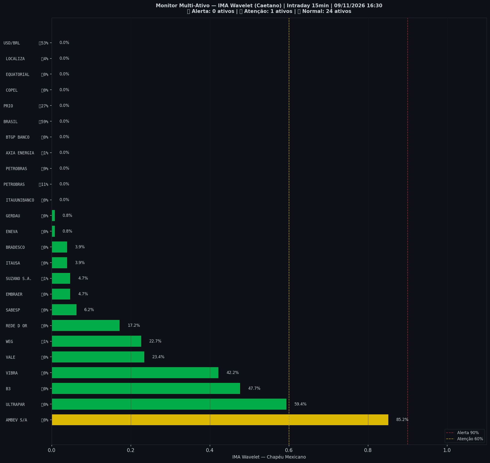

> [!warning] Onde o mercado está agora (09/11 16:15, candles de 15 min): **🟡 Esticado para cima**
> `Pânico ◀───────────────────●─▶ Euforia`
>
> O Ibovespa subiu mais rápido que o normal e está acima da sua faixa habitual.
> No gráfico diário: 🔪 Queda forte em curso.
>
> *Leitura educacional baseada em 26 anos de dados. Não é recomendação de investimento.*

> [!abstract]- 🧭 Os outros módulos neste dia (Operações e Sinais)
> | Módulo | Agora | |
> |---|---|---|
> | 📈 **Tendência MME9** | Diário — fora Semanal — fora | [abrir](operacoes/tendencia) |
> | 🎯 **Entradas do método** | ⏳ aguardando: Diário · Nadaraya, Diário · Semáforo N3 após ζ Fundo | [abrir](operacoes/entradas) |
> | 📍 **Sinais** | hoje: nenhum sinal | [abrir](sinais-topo-fundo/) |
> | 🧪 **Placar ao vivo** | 1 operação(ões), 0 com lucro, soma -0,8% | [abrir](operacoes/) |

> [!danger] IMA Intraday · 15 min (09/11 16:15): 🔴 **VERMELHO** — Risco 86% · ▼ -2 p.p. vs leitura anterior
> `█████████████████░░░`
> ALERTA — esticamento extremo (ζ ≥ 0,90): risco de reversão.

> [!warning] ⚠️ Nível alto agora — IMA Intraday · 15 min (09/11 16:15)
> - 🟡 **ζ Topo 86%** — preço esticado acima da tendência (risco de reversão)

> [!note] 🧭 IMA Diário · viés (06/11): 🔪 **Queda forte em curso**
> 📚 historicamente, quedas assim costumaram continuar um pouco antes de virar
>
> *Leitura educacional baseada em 26 anos de dados, não recomendação. [Como usar](../metodologia/crise#3-como-usar-na-prática).*

| Indicador — IMA Intraday · 15 min (09/11 16:15) | Valor |
|---|---|
| 🔴 ζ Topo — preço esticado acima da tendência | 🟡 **86%** |
| 🔵 ζ Fundo — preço esticado abaixo da tendência | 0% |
| 🫧 LPPL bolha — alta super-exponencial (risco de crash) | 0% |
| 🫧 LPPL antibolha — queda super-exponencial (risco de repique) | 0% |
| 📊 Ibovespa | 171.183 pts |

## Últimas 30 leituras (candles de 15 min)

| Data | Zona | Evento | Risco | ζ Topo | ζ Fundo | LPPL |
|---|---|---|---|---|---|---|
| 2026-11-09 16:15 | 🔴 VERMELHO |  | 🟡 **86%** | 🟡 **86%** | 0% | 0% |
| 2026-11-09 16:00 | 🔴 VERMELHO |  | 🟡 **88%** | 🟡 **88%** | 0% | 0% |
| 2026-11-09 15:45 | 🔴 VERMELHO |  | 🔴 **91%** | 🔴 **91%** | 0% | 0% |
| 2026-11-09 15:30 | 🔴 VERMELHO |  | 🔴 **91%** | 🔴 **91%** | 1% | 0% |
| 2026-11-09 15:15 | 🔴 VERMELHO |  | 🔴 **95%** | 🔴 **95%** | 1% | 0% |
| 2026-11-09 15:00 | 🔴 VERMELHO |  | 🔴 **91%** | 🔴 **91%** | 0% | 0% |
| 2026-11-09 14:45 | 🟡 AMARELO |  | 🟡 **75%** | 🟡 **75%** | 0% | 0% |
| 2026-11-09 14:30 | 🟡 AMARELO |  | 🟡 **66%** | 🟡 **66%** | 0% | 0% |
| 2026-11-09 14:15 | 🟢 VERDE |  | **55%** | 55% | 0% | 0% |
| 2026-11-09 14:00 | 🟢 VERDE |  | **43%** | 43% | 1% | 0% |
| 2026-11-09 13:45 | 🟢 VERDE |  | **37%** | 37% | 0% | 0% |
| 2026-11-09 13:30 | 🟢 VERDE |  | **32%** | 32% | 0% | 0% |
| 2026-11-09 13:15 | 🟢 VERDE |  | **32%** | 32% | 0% | 0% |
| 2026-11-09 13:00 | 🟢 VERDE |  | **33%** | 33% | 0% | 0% |
| 2026-11-09 12:45 | 🟢 VERDE |  | **30%** | 30% | 0% | 0% |
| 2026-11-09 12:30 | 🟢 VERDE |  | **29%** | 29% | 1% | 0% |
| 2026-11-09 12:15 | 🟢 VERDE |  | **28%** | 28% | 2% | 0% |
| 2026-11-09 12:00 | 🟢 VERDE |  | **26%** | 26% | 1% | 0% |
| 2026-11-09 11:45 | 🟢 VERDE |  | **25%** | 25% | 0% | 0% |
| 2026-11-09 11:30 | 🟢 VERDE |  | **23%** | 23% | 0% | 0% |
| 2026-11-09 11:15 | 🟢 VERDE |  | **20%** | 20% | 0% | 0% |
| 2026-11-09 11:00 | 🟢 VERDE |  | **19%** | 19% | 0% | 0% |
| 2026-11-09 10:45 | 🟢 VERDE |  | **17%** | 17% | 1% | 0% |
| 2026-11-09 10:30 | 🟢 VERDE |  | **11%** | 11% | 1% | 0% |
| 2026-11-09 10:15 | 🟢 VERDE |  | **8%** | 8% | 2% | 0% |
| 2026-11-09 10:00 | 🟢 VERDE |  | **4%** | 4% | 1% | 0% |
| 2026-11-06 18:00 | 🟢 VERDE |  | **2%** | 2% | 0% | 0% |
| 2026-11-06 17:45 | 🟢 VERDE |  | **2%** | 2% | 0% | 0% |
| 2026-11-06 17:30 | 🟢 VERDE |  | **2%** | 2% | 0% | 0% |
| 2026-11-06 17:15 | 🟢 VERDE |  | **3%** | 3% | 0% | 0% |

<small>Destaques: 🟡 ≥ 60% · 🔴 ≥ 90% (Risco e ζ Topo) · 🔵 ≥ 60% · 🔪 ≥ 90% (ζ Fundo) · 🫧 ≥ 30% · 🫧🔴 ≥ 50% (LPPL)</small>

## Monitor Multi-Ativo

**4% dos ativos em tensão** (0🔴 2🟡) · **0 com ζ Fundo alto** — quanto mais ativos disparam juntos, mais confiável o sinal.

> [!warning] Em destaque no multi-ativo
> 🟡 **AMBEV S/A** ζ Topo 85%

| Zona | Ativo | Setor | ζ Topo | ζ Fundo |
|---|---|---|---|---|
| 🟡 | **AMBEV S/A** | Consumo | 🟡 **85.2%** | 0.0% |
| 🟡 | **ULTRAPAR** | Outros | 59.4% | 0.0% |
| 🟢 | **BRASIL** | Financeiro | 0.0% | 58.6% |
| 🟢 | **USD/BRL** | Câmbio | 0.0% | 53.1% |
| 🟢 | **B3** | Financeiro | 47.7% | 0.0% |
| 🟢 | **VIBRA** | Energia | 42.2% | 0.0% |
| 🟢 | **PRIO** | Petróleo | 0.0% | 26.6% |
| 🟢 | **VALE** | Mineração | 23.4% | 0.0% |
| 🟢 | **WEG** | Industrial | 22.7% | 0.8% |
| 🟢 | **REDE D OR** | Saúde | 17.2% | 0.0% |
| 🟢 | **PETROBRAS** | Petróleo | 0.0% | 10.9% |
| 🟢 | **PETROBRAS** | Petróleo | 0.0% | 9.4% |
| 🟢 | **SABESP** | Saneamento | 6.2% | 0.0% |
| 🟢 | **EMBRAER** | Outros | 4.7% | 0.0% |
| 🟢 | **SUZANO S.A.** | Papel/Celulose | 4.7% | 0.8% |
| 🟢 | **ITAUSA** | Financeiro | 3.9% | 0.0% |
| 🟢 | **BRADESCO** | Financeiro | 3.9% | 0.0% |
| 🟢 | **LOCALIZA** | Aluguel | 0.0% | 3.9% |
| 🟢 | **AXIA ENERGIA** | Energia | 0.0% | 0.8% |
| 🟢 | **ENEVA** | Energia | 0.8% | 0.0% |
| 🟢 | **GERDAU** | Siderurgia | 0.8% | 0.0% |
| 🟢 | **ITAUUNIBANCO** | Financeiro | 0.0% | 0.0% |
| 🟢 | **BTGP BANCO** | Financeiro | 0.0% | 0.0% |
| 🟢 | **COPEL** | Energia | 0.0% | 0.0% |
| 🟢 | **EQUATORIAL** | Energia | 0.0% | 0.0% |

<small>Destaques: 🟡 ≥ 60% · 🔴 ≥ 90% (Risco e ζ Topo) · 🔵 ≥ 60% · 🔪 ≥ 90% (ζ Fundo) · 🫧 ≥ 30% · 🫧🔴 ≥ 50% (LPPL)</small>

*Página atualizada em 09/11/2026 16:30 BRT (leitura da barra de 2026-11-09 16:15 BRT).*

> [!warning] O que este indicador não faz
> Medido em 5 anos de Ibovespa, o ζ **não antecipa** topos nem fundos: a capacidade de separar o que sobe do que cai ficou em 0,49–0,52, e 0,50 é moeda jogada ao ar. Ele descreve o estado de agora; não é aviso do que vem. As zonas verde/amarelo/vermelho continuam na página como descrição desse estado — **não as use como sinal de entrada ou saída**.

> [!info]- Como interpretar (clique para expandir)
> - **IMA Diário** e **IMA Intraday**: o mesmo cálculo (IMA Wavelet) aplicado ao fechamento diário e a barras de 15 minutos. São leituras independentes — uma não confirma nem desmente a outra.
> - **ζ Topo**: fração dos coeficientes wavelet (Chapéu Mexicano, Caetano & Yoneyama 2009) acima de +0,8σ na faixa mais recente. Na ponta da série isso acontece quando o preço termina **esticado acima da tendência** em muitas escalas. ζ=0,90 é o limiar de Caetano.
> - **ζ Fundo**: o espelho — preço esticado abaixo da tendência.
> - **ζ olha para trás, não para frente.** Ele mede esticamento que **já aconteceu**: sobe depois que o preço subiu e cai depois que o preço caiu (correlação medida de +0,59 com o retorno recente). Por isso ζ Topo **baixo no meio de um tombo é o comportamento correto** do indicador, e não defeito: o preço deixou de estar esticado para cima. Pelo mesmo motivo, ζ Topo alto não quer dizer que a queda começa amanhã.
> - **LPPL DS-Confidence**: fração de 45 janelas (60–500 pregões) em que o modelo de Sornette produz um ajuste válido. **Bolha** (B<0): alta super-exponencial, risco de crash. **Antibolha** (B>0): queda super-exponencial, risco de repique. Evidência complementar; **não entra na zona**.
> - **Zonas com histerese**: o sinal só muda de zona ao cruzar o limiar de entrada, e só volta ao cruzar o de saída — evita flip-flop diário.

---
*Pêndulo de Mercado · entre o pânico e a euforia, onde o mercado está. Sinal IMA baseado no trabalho do Prof. Marco Antonio Leonel Caetano (IMA Wavelet, [Caetano & Yoneyama, Physica-A 2007](https://doi.org/10.1016/j.physa.2007.03.054)) e do Prof. Didier Sornette (LPPL, ETH-Zurich); Sinais de Topo e Fundo baseados no trabalho de Oliver Velez, J. Welles Wilder, Donald Lambert, John Bollinger e Alex Spiroglou. Adaptado, testado no Ibovespa e mantido por Jarbas Daniel da Costa. Os autores citados não participam do produto. · [Metodologia](metodologia/) · [Histórico](historico)*

> [!quote]- Aviso
> Conteúdo educacional. Não constitui recomendação de investimento.
