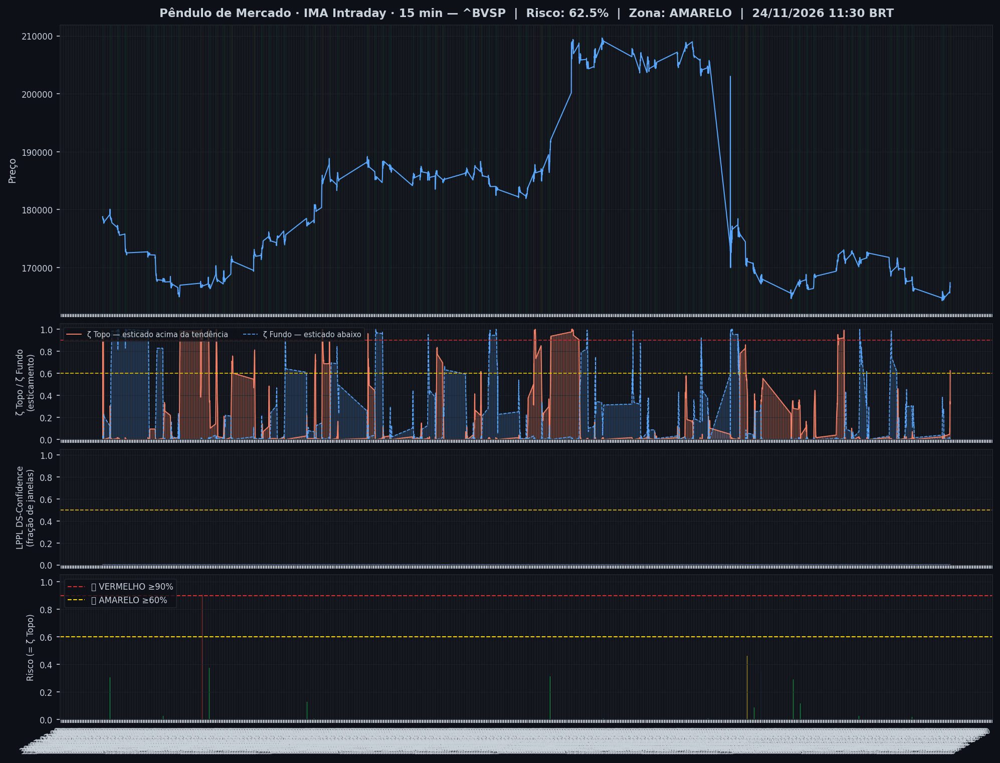

> [!warning] Onde o mercado está agora (24/11 11:30, candles de 15 min): **🟡 Esticado para cima**
> `Pânico ◀────────────────●────▶ Euforia`
>
> **O Ibovespa sobe 0,61% agora, aos 167.384 pontos.** O preço subiu mais rápido que o normal e está acima da sua faixa habitual.
> No gráfico diário: 🌱 Fundo se desfazendo.
>
> *Leitura educacional baseada em 26 anos de dados. Não é recomendação de investimento.*

> [!abstract]- 🧭 Os outros módulos neste dia (Operações e Sinais)
> | Módulo | Agora | |
> |---|---|---|
> | 📈 **Tendência MME9** | Diário — fora Semanal — fora | [abrir](operacoes/tendencia) |
> | 🎯 **Entradas do método** | — nenhuma regra com setup ativo | [abrir](operacoes/entradas) |
> | 📍 **Sinais** | hoje: nenhum sinal | [abrir](sinais-topo-fundo/) |
> | 🧪 **Placar ao vivo** | 1 operação(ões), 0 com lucro, soma -0,8% | [abrir](operacoes/) |

> [!warning] IMA Intraday · 15 min (24/11 11:30): 🟡 **AMARELO** — Risco 62% · ▲ +30 p.p. vs leitura anterior
> `████████████░░░░░░░░`
> Atenção — preço esticado acima da tendência.

> [!warning] ⚠️ Nível alto agora — IMA Intraday · 15 min (24/11 11:30)
> - 🟡 **ζ Topo 62%** — preço esticado acima da tendência (risco de reversão)

> [!note] 🧭 IMA Diário · viés (23/11): 🌱 **Fundo se desfazendo**
> 📚 só contexto: o pânico passou; sem vantagem estatística confirmada para comprar só por isso
>
> *Leitura educacional baseada em 26 anos de dados, não recomendação. [Como usar](../metodologia/crise#3-como-usar-na-prática).*

| Indicador — IMA Intraday · 15 min (24/11 11:30) | Valor |
|---|---|
| 🔴 ζ Topo — preço esticado acima da tendência | 🟡 **62%** |
| 🔵 ζ Fundo — preço esticado abaixo da tendência | 0% |
| 🫧 LPPL bolha — alta super-exponencial (risco de crash) | 0% |
| 🫧 LPPL antibolha — queda super-exponencial (risco de repique) | 0% |
| 📊 Ibovespa | 167.384 pts |

## Últimas 30 leituras (candles de 15 min)

| Data | Zona | Evento | Risco | ζ Topo | ζ Fundo | LPPL |
|---|---|---|---|---|---|---|
| 2026-11-24 11:30 | 🟡 AMARELO |  | 🟡 **62%** | 🟡 **62%** | 0% | 0% |
| 2026-11-24 11:15 | 🟢 VERDE |  | **32%** | 32% | 1% | 0% |
| 2026-11-24 11:00 | 🟢 VERDE |  | **34%** | 34% | 1% | 0% |
| 2026-11-24 10:45 | 🟢 VERDE |  | **16%** | 16% | 0% | 0% |
| 2026-11-24 10:30 | 🟢 VERDE |  | **7%** | 7% | 2% | 0% |
| 2026-11-24 10:15 | 🟢 VERDE |  | **10%** | 10% | 2% | 0% |
| 2026-11-24 10:00 | 🟢 VERDE |  | **5%** | 5% | 2% | 0% |
| 2026-11-23 18:00 | 🟢 VERDE |  | **3%** | 3% | 0% | 0% |
| 2026-11-23 17:45 | 🟢 VERDE |  | **4%** | 4% | 0% | 0% |
| 2026-11-23 17:30 | 🟢 VERDE |  | **3%** | 3% | 1% | 0% |
| 2026-11-23 17:15 | 🟢 VERDE |  | **2%** | 2% | 2% | 0% |
| 2026-11-23 17:00 | 🟢 VERDE |  | **2%** | 2% | 2% | 0% |
| 2026-11-23 16:45 | 🟢 VERDE |  | **2%** | 2% | 0% | 0% |
| 2026-11-23 16:30 | 🟢 VERDE |  | **4%** | 4% | 0% | 0% |
| 2026-11-23 16:15 | 🟢 VERDE |  | **5%** | 5% | 0% | 0% |
| 2026-11-23 16:00 | 🟢 VERDE |  | **3%** | 3% | 0% | 0% |
| 2026-11-23 15:45 | 🟢 VERDE |  | **3%** | 3% | 1% | 0% |
| 2026-11-23 15:30 | 🟢 VERDE |  | **2%** | 2% | 3% | 0% |
| 2026-11-23 15:15 | 🟢 VERDE |  | **1%** | 1% | 12% | 0% |
| 2026-11-23 15:00 | 🟢 VERDE |  | **0%** | 0% | 22% | 0% |
| 2026-11-23 14:45 | 🟢 VERDE |  | **1%** | 1% | 27% | 0% |
| 2026-11-23 14:30 | 🟢 VERDE |  | **1%** | 1% | 27% | 0% |
| 2026-11-23 14:15 | 🟢 VERDE |  | **0%** | 0% | 25% | 0% |
| 2026-11-23 14:00 | 🟢 VERDE |  | **1%** | 1% | 25% | 0% |
| 2026-11-23 13:45 | 🟢 VERDE |  | **1%** | 1% | 27% | 0% |
| 2026-11-23 13:30 | 🟢 VERDE |  | **1%** | 1% | 25% | 0% |
| 2026-11-23 13:15 | 🟢 VERDE |  | **0%** | 0% | 26% | 0% |
| 2026-11-23 13:00 | 🟢 VERDE |  | **0%** | 0% | 27% | 0% |
| 2026-11-23 12:45 | 🟢 VERDE |  | **0%** | 0% | 27% | 0% |
| 2026-11-23 12:30 | 🟢 VERDE |  | **1%** | 1% | 23% | 0% |

<small>Destaques: 🟡 ≥ 60% · 🔴 ≥ 90% (Risco e ζ Topo) · 🔵 ≥ 60% · 🔪 ≥ 90% (ζ Fundo) · 🫧 ≥ 30% · 🫧🔴 ≥ 50% (LPPL)</small>

## Monitor Multi-Ativo

**11% dos ativos em tensão** (2🔴 1🟡) · **1 com ζ Fundo alto** — quanto mais ativos disparam juntos, mais confiável o sinal.

> [!danger] Em destaque no multi-ativo
> 🔴 **BTGP BANCO** ζ Topo 99% · 🔴 **SABESP** ζ Topo 98% · 🔪 **USD/BRL** ζ Fundo 98% · 🟡 **EQUATORIAL** ζ Topo 68%

| Zona | Ativo | Setor | ζ Topo | ζ Fundo |
|---|---|---|---|---|
| 🔴 | **BTGP BANCO** | Financeiro | 🔴 **99.2%** | 0.0% |
| 🔴 | **SABESP** | Saneamento | 🔴 **98.4%** | 0.0% |
| 🟢 | **USD/BRL** | Câmbio | 1.6% | 🔪 **98.4%** |
| 🟡 | **EQUATORIAL** | Energia | 🟡 **68.0%** | 0.0% |
| 🟢 | **COPEL** | Energia | 52.3% | 0.0% |
| 🟢 | **AMBEV S/A** | Consumo | 51.6% | 0.0% |
| 🟢 | **ENEVA** | Energia | 51.6% | 0.0% |
| 🟢 | **LOCALIZA** | Aluguel | 51.6% | 1.6% |
| 🟢 | **BRADESCO** | Financeiro | 50.8% | 0.0% |
| 🟢 | **VALE** | Mineração | 0.8% | 47.7% |
| 🟢 | **REDE D OR** | Saúde | 43.0% | 0.0% |
| 🟢 | **VIBRA** | Energia | 42.2% | 0.0% |
| 🟢 | **ITAUUNIBANCO** | Financeiro | 41.4% | 0.0% |
| 🟢 | **B3** | Financeiro | 35.2% | 0.0% |
| 🟢 | **ITAUSA** | Financeiro | 34.4% | 0.0% |
| 🟢 | **AXIA ENERGIA** | Energia | 31.2% | 0.0% |
| 🟢 | **RUMO S.A.** | Outros | 25.8% | 0.0% |
| 🟢 | **PRIO** | Petróleo | 24.2% | 0.0% |
| 🟢 | **BRASIL** | Financeiro | 22.7% | 1.6% |
| 🟢 | **PETROBRAS** | Petróleo | 12.5% | 0.0% |
| 🟢 | **GERDAU** | Siderurgia | 0.8% | 7.8% |
| 🟢 | **TELEF BRASIL** | Outros | 7.8% | 0.0% |
| 🟢 | **PETROBRAS** | Petróleo | 7.0% | 0.8% |
| 🟢 | **ULTRAPAR** | Outros | 5.5% | 1.6% |
| 🟢 | **EMBRAER** | Outros | 3.1% | 1.6% |
| 🟢 | **WEG** | Industrial | 2.3% | 3.1% |
| 🟢 | **SUZANO S.A.** | Papel/Celulose | 2.3% | 0.0% |

<small>Destaques: 🟡 ≥ 60% · 🔴 ≥ 90% (Risco e ζ Topo) · 🔵 ≥ 60% · 🔪 ≥ 90% (ζ Fundo) · 🫧 ≥ 30% · 🫧🔴 ≥ 50% (LPPL)</small>

*Página atualizada em 24/11/2026 11:45 BRT (leitura da barra de 2026-11-24 11:30 BRT).*

> [!warning] O que este indicador não faz
> Medido em 5 anos de Ibovespa, o ζ **não antecipa** topos nem fundos: a capacidade de separar o que sobe do que cai ficou em 0,49–0,52, e 0,50 é moeda jogada ao ar. Ele descreve o estado de agora; não é aviso do que vem. As zonas verde/amarelo/vermelho continuam na página como descrição desse estado — **não as use como sinal de entrada ou saída**.

> [!info]- Como interpretar (clique para expandir)
> - **IMA Diário** e **IMA Intraday**: o mesmo cálculo (IMA Wavelet) aplicado ao fechamento diário e a barras de 15 minutos. São leituras independentes — uma não confirma nem desmente a outra.
> - **ζ Topo**: fração dos coeficientes wavelet (Chapéu Mexicano, Caetano & Yoneyama 2009) acima de +0,8σ na faixa mais recente. Na ponta da série isso acontece quando o preço termina **esticado acima da tendência** em muitas escalas. ζ=0,90 é o limiar de Caetano.
> - **ζ Fundo**: o espelho — preço esticado abaixo da tendência.
> - **ζ olha para trás, não para frente.** Ele mede esticamento que **já aconteceu**: sobe depois que o preço subiu e cai depois que o preço caiu (correlação medida de +0,59 com o retorno recente). Por isso ζ Topo **baixo no meio de um tombo é o comportamento correto** do indicador, e não defeito: o preço deixou de estar esticado para cima. Pelo mesmo motivo, ζ Topo alto não quer dizer que a queda começa amanhã.
> - **LPPL DS-Confidence**: fração de 45 janelas (60–500 pregões) em que o modelo de Sornette produz um ajuste válido. **Bolha** (B<0): alta super-exponencial, risco de crash. **Antibolha** (B>0): queda super-exponencial, risco de repique. Evidência complementar; **não entra na zona**.
> - **Zonas com histerese**: o sinal só muda de zona ao cruzar o limiar de entrada, e só volta ao cruzar o de saída — evita flip-flop diário.

---
*Pêndulo de Mercado · entre o pânico e a euforia, onde o mercado está. Sinal IMA baseado no trabalho do Prof. Marco Antonio Leonel Caetano (IMA Wavelet, [Caetano & Yoneyama, Physica-A 2007](https://doi.org/10.1016/j.physa.2007.03.054)) e do Prof. Didier Sornette (LPPL, ETH-Zurich); Sinais de Topo e Fundo baseados no trabalho de Oliver Velez, J. Welles Wilder, Donald Lambert, John Bollinger e Alex Spiroglou. Adaptado, testado no Ibovespa e mantido por Jarbas Daniel da Costa. Os autores citados não participam do produto. · [Metodologia](metodologia/) · [Histórico](historico)*

> [!quote]- Aviso
> Conteúdo educacional. Não constitui recomendação de investimento.
