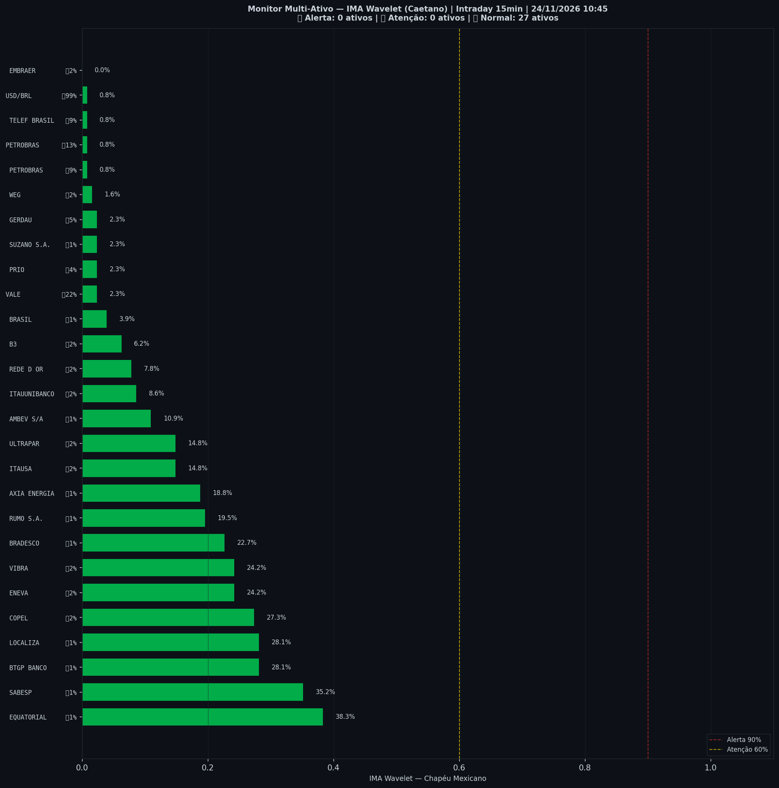

<!-- NOTAS-INICIO -->
> [!info]- 1 ponto de atenção nesta página
> **ℹ️ Cada leitura usa a última barra completa** — A barra em formação não entra. Por isso a leitura de um momento qualquer reflete o mercado de alguns minutos atrás, e as primeiras barras do dia são descartadas: ainda não existe barra completa.
>
> *Todos os pontos de atenção do site estão juntos em [Avisos](/avisos/).*
<!-- NOTAS-FIM -->

95% ζ Topo0% ζ Fundo−0,6% Dist. da média · p53

25/11/2026 18:00 BRT · candles de 15 min

> [!danger] Onde o mercado está agora (25/11 18:00, candles de 15 min): **🔴 Euforia extrema**
> `Pânico ◀────────────────────●▶ Euforia` · ζ Topo **95%** · ζ Fundo **0%** · régua = ζ Topo − ζ Fundo = **+95 p.p.**
>
> **O Ibovespa sobe 1,58% agora, aos 166.685 pontos.** O preço subiu muito acima da sua tendência. Historicamente, foi a fase com maior risco de correção.
>
> *Leitura educacional baseada em 26 anos de dados. Não é recomendação de investimento.*

> [!danger] IMA Intraday · 15 min (25/11 18:00): 🔴 **VERMELHO** — ζ Topo **95%** · ▼ -3 p.p. vs leitura anterior
> `███████████████████░` **95%**
> ALERTA — esticamento extremo (ζ ≥ 0,90): risco de reversão.

> [!danger] 🚨 Nível EXTREMO agora — IMA Intraday · 15 min (25/11 18:00)
> - 🔴 **ζ Topo 95%** — preço esticado acima da tendência (risco de reversão)

| Indicador — IMA Intraday · 15 min (25/11 18:00) | Valor |
|---|---|
| 🔴 ζ Topo — preço esticado acima da tendência | 🔴 **95%** |
| ζ Fundo — preço esticado abaixo da tendência | 0% |
| 🔴 Zona | VERMELHO |
| 📊 Ibovespa | 166.685 pts ▼ (−0,12%) |
| 📏 Distância da média | −0,6% (p53) |
| 🛰️ Fonte do preço | preço da corretora, tempo real |

## Últimas 30 leituras (candles de 15 min)

| Data | Fechamento | Zona | Evento | ζ Topo | ζ Fundo | Dist. média |
|---|---|---|---|---|---|---|
| 2026-11-25 18:00 | 166.685 ▼ | 🔴 |  | 🔴 **95%** | **0%** | −0,6% (p53) |
| 2026-11-25 17:45 | 166.880 ▲ | 🔴 |  | 🔴 **98%** | **0%** | −0,5% (p56) |
| 2026-11-25 17:30 | 166.755 ▲ | 🔴 |  | 🔴 **98%** | **0%** | −0,6% (p54) |
| 2026-11-25 17:15 | 166.752 ▼ | 🔴 |  | 🔴 **99%** | **0%** | −0,6% (p54) |
| 2026-11-25 17:00 | 166.806 ▲ | 🔴 |  | 🔴 **99%** | **0%** | −0,6% (p54) |
| 2026-11-25 16:45 | 166.662 ▼ | 🔴 |  | 🔴 **98%** | **1%** | −0,7% (p51) |
| 2026-11-25 16:30 | 166.764 ▼ | 🔴 |  | 🔴 **99%** | **0%** | −0,7% (p52) |
| 2026-11-25 16:15 | 167.063 ▲ | 🔴 |  | 🔴 **100%** | **0%** | −0,5% (p57) |
| 2026-11-25 16:00 | 166.620 ▼ | 🔴 |  | 🔴 **99%** | **0%** | −0,8% (p50) |
| 2026-11-25 15:45 | 166.845 ▼ | 🔴 |  | 🔴 **98%** | **1%** | −0,6% (p53) |
| 2026-11-25 15:30 | 166.910 ▲ | 🔴 |  | 🔴 **98%** | **0%** | −0,6% (p54) |
| 2026-11-25 15:15 | 166.835 ▲ | 🔴 |  | 🔴 **98%** | **0%** | −0,7% (p53) |
| 2026-11-25 15:00 | 166.299 ▲ | 🔴 |  | 🔴 **96%** | **0%** | −1,0% (p48) |
| 2026-11-25 14:45 | 166.262 ▲ | 🟡 |  | 🟡 **70%** | **0%** | −1,0% (p47) |
| 2026-11-25 14:30 | 166.106 ▲ | 🟢 |  | **38%** | **0%** | −1,1% (p47) |
| 2026-11-25 14:15 | 166.031 ▲ | 🟢 |  | **28%** | **1%** | −1,2% (p47) |
| 2026-11-25 14:00 | 165.901 ▲ | 🟢 |  | **23%** | **2%** | −1,3% (p46) |
| 2026-11-25 13:45 | 165.661 ▲ | 🟢 |  | **17%** | **2%** | −1,4% (p46) |
| 2026-11-25 13:30 | 164.827 ▲ | 🟢 |  | **13%** | **0%** | −1,9% (p38) |
| 2026-11-25 13:15 | 164.725 ▼ | 🟢 |  | **13%** | **0%** | −2,0% (p37) |
| 2026-11-25 13:00 | 164.812 ▼ | 🟢 |  | **13%** | **0%** | −2,0% (p37) |
| 2026-11-25 12:45 | 165.179 ▲ | 🟢 |  | **11%** | **0%** | −1,8% (p42) |
| 2026-11-25 12:30 | 165.041 ▲ | 🟢 |  | **6%** | **1%** | −1,9% (p40) |
| 2026-11-25 12:15 | 164.822 ▼ | 🟢 |  | **3%** | **2%** | −2,0% (p38) |
| 2026-11-25 12:00 | 165.299 ▲ | 🟢 |  | **2%** | **2%** | −1,8% (p42) |
| 2026-11-25 11:45 | 164.848 ▲ | 🟢 |  | **1%** | **1%** | −2,0% (p38) |
| 2026-11-25 11:30 | 164.142 ▼ | 🟢 |  | **3%** | **1%** | −2,5% (p28) |
| 2026-11-25 11:15 | 164.728 ▼ | 🟢 |  | **2%** | **0%** | −2,1% (p36) |
| 2026-11-25 11:00 | 164.765 ▲ | 🟢 |  | **3%** | **0%** | −2,1% (p36) |
| 2026-11-25 10:45 | 164.477 ▼ | 🟢 |  | **3%** | **2%** | −2,3% (p31) |

<small>Destaques: 🟡 ≥ 60% · 🔴 ≥ 90% (ζ Topo) · 🔵 ≥ 60% · 🔪 ≥ 90% (ζ Fundo) **Zona**: 🟢 calmo, 🟡 atenção e 🔴 extremo vêm do ζ Topo; 🔵 FUNDO (ζ Fundo ≥ 60%) e 🔪 FACA (≥ 90%) vêm do ζ Fundo e têm precedência, porque queda em andamento é fato medido, não previsão. **Dist. média**: a distância do preço à média dos 252 candles de 15 min — **≈ 7,6 pregões**, medido em 33 barras por pregão — e, entre parênteses, o percentil dessa distância nos 500 candles anteriores (**≈ 15 pregões**). `−8,2% (p0)` = o preço está 8,2% **abaixo** da média e nunca esteve tão abaixo em toda a janela. 🔵 ≤ p10 · 🔴 ≥ p90. É a régua simples contra a qual o ζ precisa provar que acrescenta algo.</small>

## Monitor Multi-Ativo

**37% dos ativos em tensão** (10 de 27 · 1🔪 1🔵 5🔴 3🟡) · leitura de 25/11 18:31 BRT, candles de 15 min — quanto mais ativos disparam juntos, mais confiável o sinal. 🔪 e 🔵 vêm do ζ Fundo; 🔴 e 🟡, do ζ Topo.

*Origem do preço: 26 da corretora, em tempo real · 1 da reserva, com cerca de 45 min de atraso (USD/BRL).*

> [!danger] Em destaque no multi-ativo
> 🔴 **BTGP BANCO** `BPAC11` ζ Topo 99% · 🔴 **BRADESCO** `BBDC4` ζ Topo 98% · 🔪 **AMBEV S/A** `ABEV3` ζ Fundo 98% · 🔴 **ITAUSA** `ITSA4` ζ Topo 95% · 🔴 **ENEVA** `ENEV3` ζ Topo 92% · 🟡 **PETROBRAS** `PETR4` ζ Topo 84% · 🟡 **VALE** `VALE3` ζ Topo 81% · 🟡 **EQUATORIAL** `EQTL3` ζ Topo 80% · 🔵 **USD/BRL** `USDBRL=X` ζ Fundo 71% · 🟡 **GERDAU** `GGBR4` ζ Topo 60%

| Zona | Ativo | Setor | Fechamento | ζ Topo | ζ Fundo | Dist. média |
|---|---|---|---|---|---|---|
| 🔴 | **BTGP BANCO** `BPAC11` | Financeiro | 52,95 ▼ | 🔴 **99.2%** | 0.0% | +2,8% (p80) |
| 🔴 | **BRADESCO** `BBDC4` | Financeiro | 14,19 ▼ | 🔴 **98.4%** | 0.0% | +0,8% (p71) |
| 🔪 | **AMBEV S/A** `ABEV3` | Consumo | 15,81 ▼ | 0.8% | 🔪 **98.4%** | 🔵 −0,9% (p6) |
| 🔴 | **ITAUSA** `ITSA4` | Financeiro | 13,09 ▼ | 🔴 **94.5%** | 0.0% | −0,9% (p44) |
| 🔴 | **ENEVA** `ENEV3` | Energia | 27,53 ▼ | 🔴 **92.2%** | 0.0% | 🔴 +3,9% (p90) |
| 🔴 | **PETROBRAS** `PETR4` | Petróleo | 41,36 ▲ | 🟡 **84.4%** | 0.8% | −3,5% (p67) |
| 🟡 | **VALE** `VALE3` | Mineração | 56,90 ▼ | 🟡 **81.2%** | 0.0% | −3,8% (p42) |
| 🟡 | **EQUATORIAL** `EQTL3` | Energia | 34,87 ▲ | 🟡 **79.7%** | 0.0% | +3,5% (p90) |
| 🔵 | **USD/BRL** `USDBRL=X` | Câmbio | 5,81 ▲ | 0.0% | 🔵 **71.1%** | 🔵 −0,5% (p1) |
| 🟡 | **GERDAU** `GGBR4` | Siderurgia | 25,86 ▼ | 🟡 **60.2%** | 7.8% | +2,5% (p80) |
| 🟢 | **BRASIL** `BBAS3` | Financeiro | 14,69 ▼ | 50.8% | 0.8% | +1,1% (p75) |
| 🟢 | **ULTRAPAR** `UGPA3` | Outros | 30,84 ▲ | 46.9% | 0.8% | +0,4% (p68) |
| 🟢 | **ITAUUNIBANCO** `ITUB4` | Financeiro | 40,01 ▼ | 41.4% | 0.0% | −1,3% (p45) |
| 🟢 | **PETROBRAS** `PETR3` | Petróleo | 46,69 ▼ | 40.6% | 0.0% | −4,5% (p60) |
| 🟢 | **LOCALIZA** `RENT3` | Aluguel | 29,32 ▲ | 39.8% | 0.0% | −0,1% (p61) |
| 🟢 | **VIBRA** `VBBR3` | Energia | 32,47 ▲ | 34.4% | 0.0% | 🔴 +5,6% (p99) |
| 🟢 | **COPEL** `CPLE3` | Energia | 14,90 ▼ | 1.6% | 28.1% | 🔵 −1,9% (p8) |
| 🟢 | **AXIA ENERGIA** `AXIA3` | Energia | 46,16 ▼ | 27.3% | 0.0% | −1,3% (p52) |
| 🟢 | **EMBRAER** `EMBJ3` | Outros | 103,20 ▼ | 27.3% | 25.8% | 🔵 −4,7% (p5) |
| 🟢 | **REDE D OR** `RDOR3` | Saúde | 36,80 ▼ | 25.0% | 0.8% | +1,9% (p27) |
| 🟢 | **WEG** `WEGE3` | Industrial | 49,65 ▼ | 0.0% | 20.3% | −2,0% (p14) |
| 🟢 | **PRIO** `PRIO3` | Petróleo | 60,50 ▼ | 17.2% | 1.6% | −1,5% (p63) |
| 🟢 | **B3** `B3SA3` | Financeiro | 14,58 ▲ | 13.3% | 0.0% | +0,7% (p53) |
| 🟢 | **SUZANO S.A.** `SUZB3` | Papel/Celulose | 55,40 ▼ | 0.0% | 5.5% | +0,0% (p12) |
| 🟢 | **TELEF BRASIL** `VIVT3` | Outros | 34,80 ▼ | 2.3% | 0.0% | −0,8% (p11) |
| 🟢 | **SABESP** `SBSP3` | Saneamento | 28,48 ▲ | 1.6% | 0.8% | +3,2% (p60) |
| 🟢 | **RUMO S.A.** `RAIL3` | Outros | 17,03 ▼ | 0.0% | 0.0% | +1,8% (p25) |

<small>Destaques: 🟡 ≥ 60% · 🔴 ≥ 90% (ζ Topo) · 🔵 ≥ 60% · 🔪 ≥ 90% (ζ Fundo) **Zona**: 🟢 calmo, 🟡 atenção e 🔴 extremo vêm do ζ Topo; 🔵 FUNDO (ζ Fundo ≥ 60%) e 🔪 FACA (≥ 90%) vêm do ζ Fundo e têm precedência, porque queda em andamento é fato medido, não previsão. **Dist. média**: a distância do preço à média dos 252 candles de 15 min — **≈ 7,6 pregões**, medido em 33 barras por pregão — e, entre parênteses, o percentil dessa distância nos 500 candles anteriores (**≈ 15 pregões**). `−8,2% (p0)` = o preço está 8,2% **abaixo** da média e nunca esteve tão abaixo em toda a janela. 🔵 ≤ p10 · 🔴 ≥ p90. É a régua simples contra a qual o ζ precisa provar que acrescenta algo.</small>

*Página atualizada em 25/11/2026 19:10 BRT (leitura da barra de 2026-11-25 18:00 BRT · preço da corretora, tempo real).*

> [!warning] O que este indicador não faz
> Medido em 5 anos de Ibovespa, o ζ **não antecipa** topos nem fundos: a capacidade de separar o que sobe do que cai ficou em 0,49–0,52, e 0,50 é moeda jogada ao ar. Ele descreve o estado de agora; não é aviso do que vem. As zonas verde/amarelo/vermelho continuam na página como descrição desse estado — **não as use como sinal de entrada ou saída**.

> [!info]- Como interpretar (clique para expandir)
> - **IMA Diário** e **IMA Intraday**: o mesmo cálculo (IMA Wavelet) aplicado ao fechamento diário e a barras de 15 minutos. São leituras independentes — uma não confirma nem desmente a outra.
> - **ζ Topo**: fração dos coeficientes wavelet (Chapéu Mexicano, Caetano & Yoneyama 2009) acima de +0,8σ na faixa mais recente. Na ponta da série isso acontece quando o preço termina **esticado acima da tendência** em muitas escalas. ζ=0,90 é o limiar de Caetano.
> - **ζ Fundo**: o espelho — preço esticado abaixo da tendência.
> - **ζ olha para trás, não para frente.** Ele mede esticamento que **já aconteceu**: sobe depois que o preço subiu e cai depois que o preço caiu (correlação medida de +0,59 com o retorno recente). Por isso ζ Topo **baixo no meio de um tombo é o comportamento correto** do indicador, e não defeito: o preço deixou de estar esticado para cima. Pelo mesmo motivo, ζ Topo alto não quer dizer que a queda começa amanhã.
> - **LPPL DS-Confidence**: fração de 45 janelas (60–500 pregões) em que o modelo de Sornette produz um ajuste válido. **Bolha** (B<0): alta super-exponencial, risco de crash. **Antibolha** (B>0): queda super-exponencial, risco de repique. Evidência complementar; **não entra na zona**.
> - **Zonas com histerese**: o sinal só muda de zona ao cruzar o limiar de entrada, e só volta ao cruzar o de saída — evita flip-flop diário.

---
*Pêndulo de Mercado · entre o pânico e a euforia, onde o mercado está. Sinal IMA baseado no trabalho do Prof. Marco Antonio Leonel Caetano (IMA Wavelet, [Caetano & Yoneyama, Physica-A 2007](https://doi.org/10.1016/j.physa.2007.03.054)) e do Prof. Didier Sornette (LPPL, ETH-Zurich); Sinais de Topo e Fundo baseados no trabalho de Oliver Velez, J. Welles Wilder, Donald Lambert, John Bollinger e Alex Spiroglou. Adaptado, testado no Ibovespa e mantido por Jarbas Daniel da Costa. Os autores citados não participam do produto. · [Metodologia](metodologia/) · [Histórico](historico)*

> [!quote]- Aviso
> Conteúdo educacional. Não constitui recomendação de investimento.